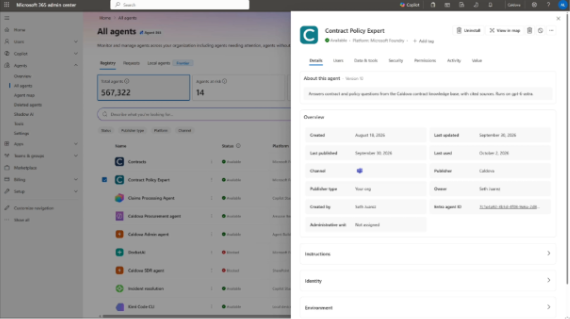
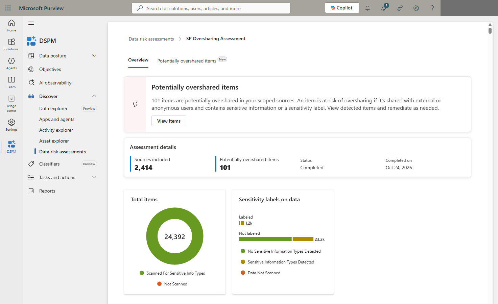
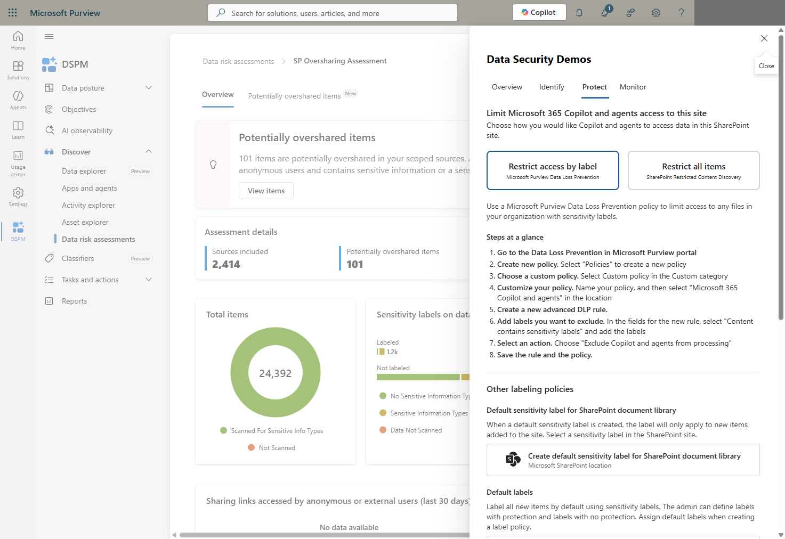

# Build an AI-ready secure foundation with Zero Trust

**Draft participant guide - Ignite 2026**

AI is transforming how people work, but secure adoption starts with a strong foundation. Apply Microsoft's Zero Trust principles to strengthen access controls, reduce risk, and protect sensitive information.

Use the Zero Trust Assessment to identify and prioritize security findings. Then use the Workshop to plan a secure foundation across identities, devices, applications, infrastructure, networks, and data.

### Using this guide during or after the session

The instructor demonstrates how to interpret findings, prepare controls, and review access and data protection. Each section includes a high-level explanation and a checkpoint you can revisit without attending the live session.

| Sections | Instructor demonstration | Your activity |
|---|---|---|
| 1-2 | Connect an assessment finding to Workshop guidance and saved notes. | Investigate two sample findings, prioritize one, and save your reasoning. |
| 3 | Review risky and dormant access; show the scoped authentication policy. | Review the access example and create the report-only policy in your lab tenant. |
| 4 | Explain update settings and the evidence needed to evaluate patching. | Create an unassigned update ring in your lab tenant. |
| 5-6 | Review agent ownership and access; identify data classification and sharing risks, then review protection options. | Follow the instructor-led overviews or revisit the summaries and screenshots later. No participant configuration or Workshop entries are required. |
| 7-8 | Review the Progress Report, next steps, and safe exit. | Check your saved notes and choose one organizational next step. |

Instructor-demo screenshots illustrate a separate prepared environment, not results from your lab tenant. Read their captions for the evidence source, what is shown, and what remains unverified. Your new policy and update ring do not produce live enforcement or patching results during this lab.

> [!Note] **Draft screenshot status**
>
> Screenshot placeholders identify captures to be added before publication; they are not completed demo evidence. Until those images are available, use the written explanations and illustrative examples. No step requires watching the live instructor demonstration.

### Before you begin

> [!WARNING]
> Complete the exercises in a lab or test tenant, not a production tenant.

1. If you are using the supplied lab environment, sign in to the **lab VM**:

    Use the VM username and password displayed by your lab platform. This GitHub guide does not substitute lab-platform credential tokens.

    If you are using a dedicated test tenant, sign in with its test account on your lab device.

2. Open **Microsoft Edge**.

3. Navigate to the **Zero Trust Workshop**:
   [https://zerotrust.microsoft.com](https://zerotrust.microsoft.com/).

Keep the Workshop open in the same browser profile throughout the lab so your notes are available in the final report.

---

## Section 1 - Zero Trust, the Assessment, and the Workshop

[Microsoft Zero Trust](https://learn.microsoft.com/en-us/security/zero-trust/zero-trust-overview) continuously verifies access using identity, device, location, behavior, and risk signals, granting only the access needed.

AI assistants and agents use identities and permissions to access organizational data. Applying Zero Trust principles helps secure that access and supports AI readiness.

Microsoft's Zero Trust approach uses three principles:

| Principle | Connection to this lab |
|---|---|
| Verify explicitly | Evaluate identity, authentication, device posture, and other available signals before granting access. |
| Use least privilege access | Limit user and agent permissions, review unnecessary access, and identify accountable owners. |
| Assume breach | Limit what a compromised identity or device can reach, protect sensitive data, and monitor for threats. |

Business enablement is the purpose of these principles: align security to the organization's mission, priorities, risks, and process.

### Understand the tools

The Assessment and Workshop answer different questions:

| Tool | Question it helps you answer | How you will use it |
|---|---|---|
| **Zero Trust Assessment** | Which security settings need attention? | Open a finding and read the results of the check. |
| **Zero Trust Workshop** | What steps can we take to improve security? | Read the guidance for a task, choose its status, and save notes about what to do next. |
| **Workshop Progress Report** | Where are we, and what comes next? | Review the roadmap alongside the task statuses and notes you saved. |

**Instructor demo overview:** Move from the prepared Assessment to a matching Workshop task, open **View details**, and show where to set **In Planning**, enter **Notes**, and **Save**. Finally, locate **Actions > Report**. These are separate tools and manual steps: creating a control in a product portal does not automatically update the Workshop.

> [!Note] **Screenshot placeholder S01 - Assessment and Workshop orientation**
>
> Add the prepared Assessment overview, a Workshop task with View details and Status/Notes/Save visible, and the Actions > Report entry point. Caption the route from finding to guidance to saved plan. Use sample notes identified as illustrative, not verified tenant results.
> Images: `images/01a-assessment-overview.png`, `images/01b-workshop-task.png`, and `images/01c-workshop-report-entry.png`.

### Use the prepared assessment

This lab uses the [prepared sample report](https://microsoft.github.io/zerotrustassessment/demo/).

After the lab, you can run the Zero Trust Assessment in your own environment to identify potential security gaps. [Learn how to run the assessment](https://github.com/microsoft/zerotrustassessment).

Changes in your lab tenant do not update the sample report or your Workshop notes. Record your findings and progress in the Workshop.

Next, review two findings, prioritize one, and record your reasoning in the Workshop.

---

## Section 2 - Assess the critical gaps

Review two findings. Note what each confirms and what remains unknown, then prioritize one.

**Instructor demo overview:** Open a finding, read its supporting evidence, and connect it to a Workshop task. Method registration does not establish that phishing-resistant sign-in is enforced, and update-policy settings do not establish that devices installed updates. The demonstration ends with a saved priority rationale and follow-up evidence, not a claim that the gaps have been fixed. Screenshots S04-S05 will show the two findings.

1. Open the **prepared Zero Trust Assessment** in a new browser tab:
   [https://microsoft.github.io/zerotrustassessment/demo/](https://microsoft.github.io/zerotrustassessment/demo/).

2. Select **Identity**.

3. Under **Assessment results**, select:
   **Privileged accounts have phishing-resistant methods registered**.

    > [!Note] **Screenshot placeholder S04 - Identity finding details**
    >
    > Add the method-registration finding with its status, explanation, and supporting evidence.
    > Image: `images/04-identity-assessment-finding.png`.

4. Review the finding's status, explanation, and supporting evidence.

5. Record what the finding confirms about method registration.
   Note the additional evidence needed to verify sign-in enforcement.

6. Select **Devices**.

7. Locate the finding about update policies and risk from unpatched vulnerabilities.
   Open its details.

    > [!Note] **Screenshot placeholder S05 - Device update finding details**
    >
    > Add the update-policy finding with the configuration and assignment evidence it checks.
    > Image: `images/05-device-update-assessment-finding.png`.

8. Review whether the evidence covers:
    - Policy configuration.
    - Policy assignment.
    - Update installation results.

9. Record the evidence still needed to evaluate the **14-day patching objective**.

10. Choose one finding to prioritize.
    Record your reason based on affected accounts or devices, potential exposure, and evidence gaps.

11. Return to the **Zero Trust Workshop** tab.

12. Navigate to the task matching your priority:
    - **Identity > Rollout Conditional Access with Authentication Strength controls**, or
    - **Devices > Update Rings**.

13. Select **View details**.
    Review the guidance, then return to the task.

14. Set **Status** to **In Planning**.

15. In **Notes**, enter your observations, priority rationale, and follow-up evidence.
    Use the template below.

16. Select **Save**.

> [!Hint] Some product names are obfuscated in the sample report. Use the check's description and supporting evidence to identify the finding.

**Workshop note template**

```text
Identity: [finding, evidence, and its limits].
Devices: [finding, evidence, and its limits].
Priority: [which finding to address first and why].
Follow-up: [additional evidence needed].
```

### Check your work

Confirm your saved Workshop note includes both findings, the priority and rationale, and needed follow-up evidence. Keep it for adding policy details in Sections 3 and 4.

---

## Section 3 - Phishing-resistant authentication; remove risky and dormant access

Review risky and dormant access, then configure a report-only Conditional Access policy for phishing-resistant authentication.

Authentication and access review address different questions: **How should this identity sign in?** and **Should it still have this access?**

### Instructor demonstration - Review risky and dormant access

In Entra, review risk detections and sign-in activity alongside the account's permissions. Check why the account needs access before deciding what to change.

The instructor demonstrates how to combine these signals rather than treating a risk flag or an old sign-in date as an automatic removal decision. If you are working independently, use the following summary and written example; your lab tenant does not need populated risk or sign-in data.

| Demo checkpoint | What to look for | What it does not establish |
|---|---|---|
| Risk detections and sign-in context | What was detected, when it occurred, and the affected account and sign-in. | A detection alone does not determine the appropriate response. |
| Interactive and non-interactive activity | Whether the account is inactive across the relevant sign-in types. | No recent interactive sign-in alone does not prove the account is unused. |
| Permissions and resource-owner review | What the account can access, why it needs access, and who can confirm that need. | An old account or broad permission alone does not authorize removal. |

**Illustrative example:** An account has access to a sensitive application but no interactive sign-ins in 120 days. Before removing access, check non-interactive activity and confirm the account's purpose with the resource owner. A separate account has recent risk detections; review the detection details and sign-in context to decide how to respond.

For each account in the example, identify what you would investigate before deciding whether to retain or remove access.

> [!Note] **Screenshot placeholder S06 - Risky and dormant access review**
>
> Add the instructor's risk-detection/sign-in context, interactive and non-interactive activity, and relevant access evidence. Use synthetic or sanitized demo data. Keep each example account identifiable across its captures, and caption the investigation and owner confirmation still needed. Do not depict access removal as a required lab step.
> Images: `images/06a-risk-and-sign-in-context.png`, `images/06b-account-activity.png`, and `images/06c-account-access.png`.

### Create a scoped report-only policy

**Instructor demo overview:** Show the empty pilot group, the policy's user and resource scope, the phishing-resistant authentication strength, and the saved Report-only state. Screenshots S07-S09 will provide the configuration checkpoints. The saved policy is the output; enforcement and sign-in results are not. Follow the steps below to create your own configuration.

Reference: [Conditional Access with phishing-resistant MFA](https://learn.microsoft.com/en-us/entra/identity/conditional-access/policy-admin-phish-resistant-mfa).

Use an **empty pilot security group** and **Report-only** mode to practice configuring the policy without affecting sign-ins.

1. Sign in to the **Microsoft Entra admin center** with your **Cloud Admin** account:
   [https://entra.microsoft.com](https://entra.microsoft.com/).

    Use the Cloud Admin username and password displayed by your lab platform. For a dedicated test tenant, use its authorized test administrator account.

    > [!WARNING]
    > If sign-in requires a Temporary Access Pass (TAP) that the platform has not supplied, stop and contact your lab proctor or lab provider. Do not disable tenant authentication requirements or use a production account to continue.

2. Confirm the tenant name or domain.

    > [!Hint] If Conditional Access is unavailable, verify the tenant, account permissions, and licensing.

3. Navigate to:
   **Entra ID > Groups > All groups**.

4. Select **New group**.

5. Enter the following group settings:

    - **Group type:** Security
    - **Group name:** `ZT-Lab-PhishingResistant-Pilot`
    - **Membership type:** Assigned
    - **Members:** Leave empty.
    - **Microsoft Entra roles can be assigned to the group:** **No**, if displayed.

6. Select **Create**.

7. Open the saved group and confirm that it has **no members**.

    > [!Note] **Screenshot placeholder S07 - Empty pilot group**
    >
    > Add the saved security group's name and empty membership.
    > Image: `images/07-empty-pilot-group.png`.

8. Navigate to:
   **Entra ID > Conditional Access > Policies**.

9. Select **New policy**.

10. Name the policy:
    `ZT-Lab-Require-Phishing-Resistant-MFA`

11. Go to **Assignments > Users** (or **Users or workload identities**).

12. Under **Include**, select:
    **Select users and groups > Users and groups**.

13. Select only the following group:
    `ZT-Lab-PhishingResistant-Pilot`.

14. Go to **Target resources > Resources**.
    Select **All resources**.

    > [!Note] **Screenshot placeholder S08 - Conditional Access policy scope**
    >
    > Add the policy's selected pilot group and All resources scope.
    > Image: `images/08-conditional-access-scope.png`.

15. Go to **Access controls > Grant**.

16. Select **Grant access**.

17. Select **Require authentication strength**.

18. Choose **Phishing-resistant MFA strength**.

19. Select **Select** to save the grant settings.

    > [!Note] **Screenshot placeholder S09a - Authentication strength**
    >
    > Add the Phishing-resistant MFA strength selection.
    > Image: `images/09a-phishing-resistant-strength.png`.

20. Under **Enable policy**, select **Report-only**.
    Do not select **On**.

    > [!Note] Leave the pilot group empty and the policy in **Report-only** mode for this lab.
    > Before a real rollout, prepare authentication methods and emergency-access exclusions, add pilot users, and [review report-only results](https://learn.microsoft.com/en-us/entra/identity/conditional-access/concept-conditional-access-report-only#reviewing-results) before considering enforcement.

21. Review the configuration:
    - **Users:** Only the empty `ZT-Lab-PhishingResistant-Pilot` group.
    - **Target resources:** **All resources**.
    - **Grant:** **Require authentication strength > Phishing-resistant MFA strength**.
    - **Enable policy:** **Report-only**.

22. Select **Create**.

23. Open the saved policy.
    Confirm that its settings match the configuration above.

    > [!Note] **Screenshot placeholder S09b - Saved report-only policy**
    >
    > Add the saved Report-only policy state.
    > Image: `images/09b-report-only-policy.png`.

24. Return to the **Zero Trust Workshop** tab.

25. Navigate to:
    **Identity > Rollout Conditional Access with Authentication Strength controls**.

26. Set **Status** to **In Planning**.

27. In **Notes**, append the policy details and the checks needed before enforcement.
    Keep your existing assessment observations. For example:

    ```text
    Created ZT-Lab-Require-Phishing-Resistant-MFA in Report-only mode,
    scoped to the empty pilot group.
    Next: Prepare methods and emergency-access exclusions, then add pilot
    users and review report-only sign-in results before enforcement.
    ```

28. Select **Save**.

> [!Note] Phishing-resistant methods include passkeys (FIDO2) and Windows Hello for Business. Authenticator push approval or number matching alone does not meet this authentication strength.

### Check your work

Confirm the saved policy targets only the empty pilot group, covers **All resources**, requires **Phishing-resistant MFA strength**, and remains **Report-only**. Confirm your Workshop note is saved.

Keep the group empty and leave the policy in Report-only mode for the lab. With no members, there will be no sign-ins to evaluate against this policy. Leave the Workshop task **In Planning** because testing and rollout are still needed.

---

## Section 4 - Patch devices within 14 days

Create a Windows update ring to support installing quality updates within 14 days. The assessment check you reviewed examines update policies. To check whether devices meet the 14-day goal, you also need installation results.

Leave the ring unassigned for this lab. Its deferral, deadline, and grace settings control when updates are offered and when installation and restarts are required.

### Create an unassigned Windows update ring

**Instructor demo overview:** Connect the 0-day quality-update deferral, 7-day deadline, and 2-day grace period to a pilot rollout, then inspect the saved ring and its empty assignments. Screenshots S11-S13 will show these checkpoints. The ring prepares settings for a later deployment; it does not demonstrate that devices met the 14-day objective. Follow the steps below to create your own configuration.

References: [Create update rings](https://learn.microsoft.com/en-us/intune/device-updates/windows/manage-update-rings) and [Update ring settings](https://learn.microsoft.com/en-us/intune/device-updates/windows/ref-update-ring-settings).

1. Sign in to the **Microsoft Intune admin center** with your **Cloud Admin** account:
   [https://intune.microsoft.com](https://intune.microsoft.com/).

    Use the Cloud Admin credentials displayed by your lab platform, or your authorized test administrator account. If a required TAP is unavailable, contact your lab proctor or lab provider before continuing.

2. Confirm the tenant name or domain.

    > [!Hint] If Windows updates is unavailable, verify the tenant, account permissions, and Intune licensing.

3. Navigate to:
   **Devices > By platform > Windows > Manage updates > Windows updates**.

    > [!Hint] In some portal layouts, Windows updates appears directly under the Windows management menu. Select its **Update rings** page.

4. Select the **Update rings** tab.

5. Select **Create profile**.

    > [!Note] **Screenshot placeholder S11 - Create an update ring**
    >
    > Add the Windows updates > Update rings page and Create profile entry point.
    > Image: `images/11-update-rings-entry.png`.

6. Under **Basics**, enter:

    - **Name:** `ZT-Lab-Windows-Update-Ring`
    - **Description:** `Pilot settings for a 14-day quality-update objective.`

7. Select **Next**.

8. Under **Update ring settings**, set:
    - **Quality update deferral period (days):** `0`.
    - **Feature update deferral period (days):** `0`.
    - **Upgrade Windows 10 devices to Latest Windows 11 release:** **No**.

9. Set **Automatic update behavior** to:
   **Auto install at maintenance time**.

10. Set the active hours:
    - **Active hours start:** `8 AM` / `08:00`
    - **Active hours end:** `5 PM` / `17:00`

    > [!Note] **Screenshot placeholder S12a - Update settings**
    >
    > Add the quality-update deferral and update behavior with the lab values.
    > Image: `images/12a-update-settings.png`.

11. Set **Use deadline settings** to **Allow**.

12. Enter the deadline and restart settings:
    - **Deadline for quality updates:** `7` days.
    - **Deadline for feature updates:** `14` days.
    - **Grace period:** `2` days.
    - **Auto reboot before deadline:** **Yes**.

    > [!Note] **Screenshot placeholder S12b - Deadline settings**
    >
    > Add the quality-update deadline, grace period, and auto-reboot settings with the lab values.
    > Image: `images/12b-deadline-settings.png`.

13. Leave all other settings at their displayed defaults.
    Select **Next**.

14. On **Scope tags**, retain the default selection.
    Select **Next**.

15. On **Assignments**, leave all group assignments empty.

    > [!Note] Do not add groups, **All users**, or **All devices**. Leave this ring unassigned for the lab.

16. Select **Next**.

17. Review the settings.
    Confirm there are **no assignments**.

18. Select **Create**.

19. Open the saved `ZT-Lab-Windows-Update-Ring`.

20. Select **Properties**.
    Confirm:
    - **Quality update deferral period:** `0` days.
    - **Deadline for quality updates:** `7` days.
    - **Grace period:** `2` days.
    - **Assignments:** No groups assigned.

    > [!Note] **Screenshot placeholder S13 - Saved unassigned ring**
    >
    > Add the saved ring's properties showing its name and empty assignment list.
    > Image: `images/13-unassigned-update-ring.png`.

21. Return to the **Zero Trust Workshop** tab.

22. Navigate to:
    **Devices > Update Rings**.

23. Set **Status** to **In Planning**.

24. In **Notes**, append the ring settings and how you would verify timely installation.
    Keep your existing assessment observations. For example:

    ```text
    Created ZT-Lab-Windows-Update-Ring without assignments.
    Quality updates: 0-day deferral, 7-day deadline, 2-day grace period.
    Next: Pilot the ring and compare device installation/restart results
    with update release dates to track the 14-day objective.
    ```

25. Select **Save**.

> [!Note] Quality-update deadlines depend on when devices discover updates and complete restarts. Use installation reporting to track the 14-day objective, including offline devices. Feature updates have a separate deadline.

### Check your work

Confirm that `ZT-Lab-Windows-Update-Ring` has the specified settings and **no assignments**, and that your Workshop note is saved. With no devices assigned, the ring's device-status report will be empty.

To evaluate the 14-day target in a deployment, compare update release dates with each in-scope device's installed update/build, installation timing, and restart status. Include overdue and offline devices in the follow-up. Capture this reporting step in your Workshop note.

---

## Section 5 - Inventory agents, owners, and access

This section is instructor-led, with no lab exercise. An overview follows.

Agents should have an accountable owner and only the access needed for their purpose, consistent with Zero Trust least privilege. The Agent 365 registry in the Microsoft 365 admin center provides a starting point for reviewing agents. Available details vary by agent capabilities; permissions and resource-side access evidence establish what an agent can access.

### Inventory, ownership, and access

- **Inventory:** A record of agents and their intended jobs provides a starting point for governance.
- **Ownership:** An accountable owner is responsible for an agent's use. A publisher or creator is not necessarily the current owner.
- **Access:** The resources and operations available to an agent should match its job. Application permissions allow access without a signed-in user; delegated access is bounded by the signed-in user's permissions and the granted scopes.

### Example - Contract Policy Expert

The supplied demo screenshots follow **Contract Policy Expert**, an agent for answering contract-policy questions. Together, they connect its purpose and ownership information with its configured knowledge, tools, and usage.



**Inventory and ownership:** The Details pane places the agent's description, publisher, owner, and identifying information together. These fields help establish which agent is being reviewed and who should confirm its purpose and access needs. Publisher and owner are distinct fields.


**Knowledge and tools:** The Data & tools tab shows a configured knowledge source, a retrieval tool, and a contract-policy skill. They help explain how the agent is intended to answer questions. Configured sources are not a complete list of everything it can access; permissions and resource-side evidence are still needed to assess effective access.


**Usage:** The Activity tab shows active users, sessions, exceptions, and trends. This helps prioritize review and understand how much the agent is used. Usage does not establish that its permissions are appropriate or its answers are correct.

> [!Note] **Screenshot placeholder S15 - Complete the access review**
>
> Add populated permissions and supporting resource-side access evidence for Contract Policy Expert. Show the permission type, allowed operations, and resources, then compare them with the agent's purpose. Explain whether access uses the agent's own permissions or a signed-in user's delegated access. The screenshots above do not establish excess access.
> Images: `images/15a-agent-permissions.png` and `images/15b-agent-resource-access.png`.

**Key takeaway:** Know the agent's job, identify its owner, and verify that its access matches its purpose.

### Learn more

- [Agent registry](https://learn.microsoft.com/en-us/microsoft-agent-365/admin/agent-registry-overview)
- [Agent details and permissions](https://learn.microsoft.com/en-us/microsoft-agent-365/admin/agent-details#agent-permissions)
- [Agent access: its own identity or a person's behalf](https://learn.microsoft.com/en-us/microsoft-agent-365/guidance/agent-authority)
- [Microsoft Agent 365 overview](https://learn.microsoft.com/en-us/microsoft-agent-365/overview)
- [Zero Trust Workshop: AI security](https://learn.microsoft.com/en-us/security/zero-trust/workshop-zero-trust-ai-security)

---

## Section 6 - Classify and protect data

This section is instructor-led, with no lab exercise. An overview follows.

Sensitive information needs an appropriate classification and protection, consistent with Zero Trust least privilege. Microsoft Purview Data Security Posture Management (DSPM) provides a starting point for finding classification gaps and potential oversharing. Microsoft 365 Copilot respects existing permissions; it does not correct permissions that are too broad.

### Classification and protection

- **Sensitivity:** A classification taxonomy defines sensitivity levels and how information should be handled.
- **Classification:** A sensitivity label identifies the information's classification. A **Confidential** marking alone does not restrict access.
- **Protection:** Sharing permissions and label-applied encryption can restrict access and usage. A separate, label-based Data Loss Prevention (DLP) policy can restrict processing by Copilot and agents.

### Example - A classified file still needs access review

**This file is labeled Confidential. Is its access appropriate?** The demo screenshots follow one finding from **SP Oversharing Assessment**, connecting classification and sharing information with protection options.



**Classification and exposure:** The assessment reports approximately 23.2K unlabeled items and 101 potentially overshared items. These identify different review needs: classification coverage and sharing risk. Neither count establishes a confirmed leak.


**Access review:** **Test document for labeling.docx** has the label **Confidential/All employees** and an **Everyone** sharing link flagged for review. The classification is present; the owner still needs to validate the link's audience, business need, and effective protection before access is changed.



**Protection and AI:** The site's **Protect** tab explains how a label-based DLP policy can **Exclude Copilot and agents from processing**. This is an option for information that should not be processed by AI, not a substitute for correcting inappropriate SharePoint access.

> [!Note] **Demo evidence**
>
> Captured in the instructor demo tenant on November 12, 2026; the assessment completed October 24. Account and owner names are masked. These views show recorded findings and protection guidance, not tested current access, encryption settings, or an enabled DLP policy. No remediation was performed. The [supporting review-actions view](images/17b-dspm-review-actions.png) shows an available link-removal action, not a completed change.

**Key takeaway:** Before expanding Copilot, review a sensitive-data location: check its classification, validate who can access it, and verify the protection it needs.

### Learn more

- [DSPM data risk assessments and remediation](https://learn.microsoft.com/en-us/purview/data-security-posture-management-oversharing)
- [Sensitivity labels](https://learn.microsoft.com/en-us/purview/sensitivity-labels)
- [Apply encryption using sensitivity labels](https://learn.microsoft.com/en-us/purview/encryption-sensitivity-labels)
- [Copilot permissions, labels, and encryption](https://learn.microsoft.com/en-us/copilot/plan/architecture-data-protection-auditing)
- [Secure data with Zero Trust](https://learn.microsoft.com/en-us/security/zero-trust/deploy/data)

**Workshop connections:** [Define the taxonomy](https://microsoft.github.io/zerotrustassessment/docs/workshop-guidance/data/RMT_006), [manually classify sensitive assets](https://microsoft.github.io/zerotrustassessment/docs/workshop-guidance/data/RMT_008), and [protect critical assets](https://microsoft.github.io/zerotrustassessment/docs/workshop-guidance/data/RMT_025). The first two introduce classification through a pilot without usage restrictions; protection is a subsequent decision. This overview shows review evidence and protection guidance, not completion of those deployment steps.

---

## Section 7 - Review your Workshop Progress Report

Open the Workshop report to review your saved task statuses and notes. Check that your notes describe what you found, the policies you created, and what you would do next.

**Instructor demo overview:** Open **Actions > Report**, filter the relevant pillars, and connect the roadmap and task statuses to the saved Workshop Notes. Screenshots S18-S20 will show where to find each output. The report reflects recorded planning progress; an **In Planning** task or a saved configuration note is not proof of effective protection.

1. Return to your [Zero Trust Workshop](https://zerotrust.microsoft.com/) tab.

2. Open each of the following tasks:
    - **Identity > Rollout Conditional Access with Authentication Strength controls**.
    - **Devices > Update Rings**.

3. Confirm that your assessment observations and configuration notes are saved.

4. Select **Actions > Report**.
   Allow the report to open in a new tab.

    > [!Note] **Screenshot placeholder S18 - Open the Progress Report**
    >
    > Add Actions > Report and the Progress Report header with pillar filters.
    > Images: `images/18a-open-progress-report.png` and `images/18b-progress-report-header.png`.

5. Use the **Identity** and **Devices** pillar filters to review your policy work.

6. Go to **Implementation Roadmap**.
   Compare the recommended authentication and device-update steps with the next steps in your notes.

7. Go to **Task Summary**.
   Find the authentication-strength and update-ring tasks.

8. Review **Status Distribution**.
   Check how the tasks' **In Planning** statuses appear.

    > [!Note] **Screenshot placeholder S19 - Roadmap and task statuses**
    >
    > Add the Identity/Devices roadmap and task summary with the lab tasks In Planning.
    > Image: `images/19-roadmap-and-status.png`.

9. Go to **Workshop Notes**.
   Confirm that the report includes:
    - Your assessment observations.
    - Your chosen priority and rationale.
    - Your Conditional Access policy notes.
    - Your update-ring notes.

    > [!Note] **Screenshot placeholder S20 - Workshop Notes**
    >
    > Add Workshop Notes showing the assessment observations, identity and device policy notes, and next steps from the hands-on exercises.
    > Image: `images/20-workshop-notes-report.png`.

10. Choose one next step to take back to your organization.

11. If the next step is missing from your notes:
    - Return to the relevant Workshop task.
    - Append the next step in **Notes**.
    - Select **Save**.
    - Return to the report tab and refresh the page.

### Check your work

Confirm the report includes your assessment notes, both policy notes, and your next steps. Sections 5 and 6 are instructor-led references and do not require report entries. Update your notes as you test and deploy changes.

---

## Section 8 - Review and next steps

### Review

Review what you learned about each AI-readiness action:

| AI-readiness action | What you practiced or reviewed | Next step |
|---|---|---|
| Phishing-resistant authentication | Created a scoped, report-only authentication policy. | Prepare methods and test with a pilot group. |
| Remove risky and dormant access | Reviewed risk and inactivity as separate reasons to investigate access. | Review access with resource owners. |
| Patch devices within 14 days | Created an update ring and identified the installation results needed. | Pilot the ring and track installation results. |
| Inventory agents, owners, and access | Reviewed who owns an agent and which permissions it needs. | Identify agents needing ownership or access review. |
| Classify and protect data | Compared document markings with encryption and access restrictions. | Review labels and protection settings for sensitive data. |

**Take back to your organization:** Choose one security issue to address. Use the Workshop guidance to plan the changes and decide how you will check that they work.

### Before you leave

1. Return to the **Microsoft Entra admin center**:
   [https://entra.microsoft.com](https://entra.microsoft.com/).

2. Navigate to:
   **Entra ID > Conditional Access > Policies**.

3. Open `ZT-Lab-Require-Phishing-Resistant-MFA`.
   Confirm it remains **Report-only** and targets only the empty lab pilot group.

4. Return to the **Microsoft Intune admin center**:
   [https://intune.microsoft.com](https://intune.microsoft.com/).

5. Navigate to:
   **Devices > By platform > Windows > Manage updates > Windows updates > Update rings**.

6. Open `ZT-Lab-Windows-Update-Ring`.
   Under **Properties**, confirm there are **no assignments**.

7. Return to your **Workshop Progress Report** tab.
   Review your saved notes and next steps.

    > [!Note] If you are using a temporary lab environment, follow the platform's instructions for retaining your work before it expires.

8. Sign out of the admin portals when finished.

**End of Lab**

---

## Additional resources

- [Zero Trust Assessment demo](https://microsoft.github.io/zerotrustassessment/demo/).
- [Zero Trust Workshop](https://zerotrust.microsoft.com/).
- [Microsoft Zero Trust guidance](https://learn.microsoft.com/en-us/security/zero-trust/).
- [Microsoft Zero Trust overview](https://learn.microsoft.com/en-us/security/zero-trust/zero-trust-overview).
- [Microsoft Agent 365 overview](https://learn.microsoft.com/en-us/microsoft-agent-365/overview).
- [Conditional Access: phishing-resistant MFA](https://learn.microsoft.com/en-us/entra/identity/conditional-access/policy-admin-phish-resistant-mfa).
- [Conditional Access: report-only mode](https://learn.microsoft.com/en-us/entra/identity/conditional-access/concept-conditional-access-report-only).
- [Intune: manage Windows update rings](https://learn.microsoft.com/en-us/intune/device-updates/windows/manage-update-rings).
- [Intune: update ring settings](https://learn.microsoft.com/en-us/intune/device-updates/windows/ref-update-ring-settings).
- [Windows: enforcing update compliance deadlines](https://learn.microsoft.com/en-us/windows/deployment/update/wufb-compliancedeadlines).
