# Build an AI-Ready Secure Foundation with Zero Trust

Secure AI adoption depends on a strong security foundation across your organization. Zero Trust helps you strengthen that foundation by verifying access, limiting permissions, and preparing for threats.

Use the <[Microsoft Zero Trust Workshop and Assessment](https://microsoft.github.io/zerotrustassessment/) to turn security findings into a practical action plan. The Assessment helps you understand your current security posture. The Workshop provides deployment guidance and organizes improvements into **First**, **Then**, and **Next**.

### Lab overview

Start with sample assessment results to identify priorities for your Zero Trust roadmap. Use the Workshop guidance to plan improvements and practice selected configuration steps in your lab tenant.

Record your findings and next steps in the Workshop, then use its Progress Report to review your action plan. The lab prepares policies for future testing and rollout. It does not enforce access controls or deploy updates.

### Before you begin

You need access to Entra Conditional Access and Intune, with permission to create groups and policies. The user-risk policy requires Microsoft Entra ID P2.

1. Log in to your **lab VM** using the credentials below:

	**Username: ++@lab.VirtualMachine(LAB711).Username++**

	**Temporary Access Pass: +++@lab.Variable(TAP)+++**

	**Password: +++@lab.VirtualMachine(LAB711).Password+++**

2. Open **Microsoft Edge** and navigate to +++https://zerotrust.microsoft.com/+++.

Keep the Workshop open in the same browser profile throughout the lab so your notes are available in the final report.

===

## Section 1 - Zero Trust, the Assessment, and the Workshop

<[Zero Trust](https://learn.microsoft.com/en-us/security/zero-trust/zero-trust-overview) is a modern security approach based on a simple idea: **never trust, always verify**.

AI assistants and agents use identities and permissions to access organizational data. Before expanding AI use, understand your current security posture and prioritize the improvements needed to support secure adoption.

Zero Trust uses three principles:

| Principle |  |
|---|---|
| Verify explicitly | Evaluate identity, authentication, device posture, and other available signals before granting access. |
| Use least privilege access | Limit user and agent permissions, review unnecessary access, and identify accountable owners. |
| Assume breach | Limit what a compromised identity or device can reach, protect sensitive data, and monitor for threats. |

**Business enablement:** Apply these principles to support your organization's priorities and manage risk.

### Use the Assessment and Workshop together

The Workshop and Assessment help you **learn, plan, and assess**. Following the <[Zero Trust Workshop Plan](https://microsoft.github.io/zerotrustassessment/guide), start with assessment results, then use Workshop tasks to prioritize improvements and build an action plan.

1. **Establish your baseline with the Assessment.**
   Open the prepared sample report in a new tab: +++https://microsoft.github.io/zerotrustassessment/demo/+++.

    Review results by pillar. For example, an Identity check shows whether privileged accounts have phishing-resistant methods registered.

    These are sample results, not a live report from your lab tenant. After the lab, you can <[run the assessment in your own environment](https://github.com/microsoft/zerotrustassessment).

    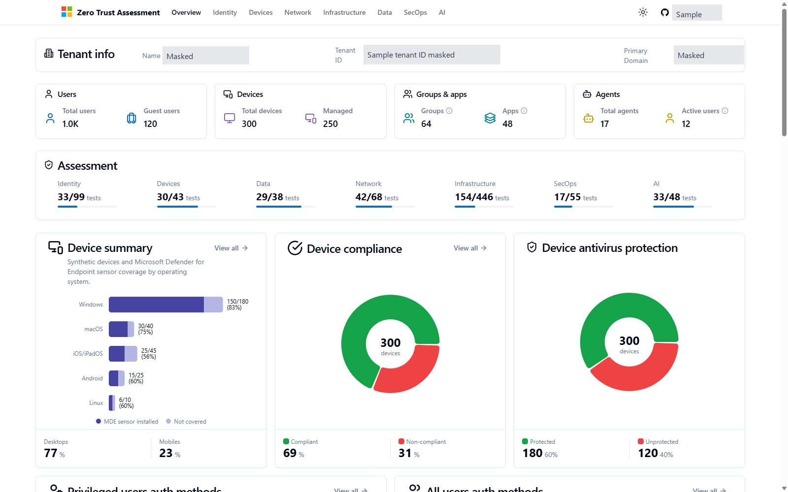

2. **Prioritize improvements in the Workshop.**
   The Workshop groups tasks into **First**, **Then**, and **Next** to help you build your Zero Trust roadmap.

    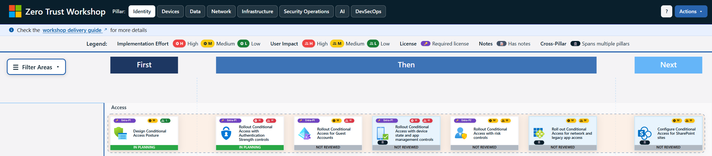

    Return to the **Zero Trust Workshop** tab. Find the matching task, such as **Rollout Conditional Access with Authentication Strength controls** for the Identity example.

    Select **View details** to read the guidance, then return to the **Zero Trust Workshop** tab.

    Set **Status** to **In Planning**. You can use **Notes** to capture:
    - What the assessment shows.
    - Why this improvement is a priority.
    - What you plan to change and how you will check it.

    Select **Save**.

    Portal changes do not update the Workshop automatically. Add your configuration results and any blockers to your existing notes as you continue.

    

3. **Build your action plan with the Progress Report.**
   In Section 7 of this lab, you will select **Actions > Report** in the upper-right corner to generate a summary of your Workshop progress. You will use it alongside the assessment results to review findings and prioritize next steps.

    

These examples are a starting point. In the next section's hands-on time, explore the Assessment results and Workshop guidance that interest you.

===

## Section 2 - Review assessment results and prioritize improvements

Review two sample results and decide which improvement you would address first. Save your observations about both in the matching Workshop task's **Notes** in step 15.

1. Return to the **Zero Trust Assessment sample report** tab.

2. Select **Identity**.

3. Under **Assessment results**, select:
   **Privileged accounts have phishing-resistant methods registered**.

    The sample reports **Failed** for method registration. This does not show whether sign-ins require phishing-resistant authentication.

    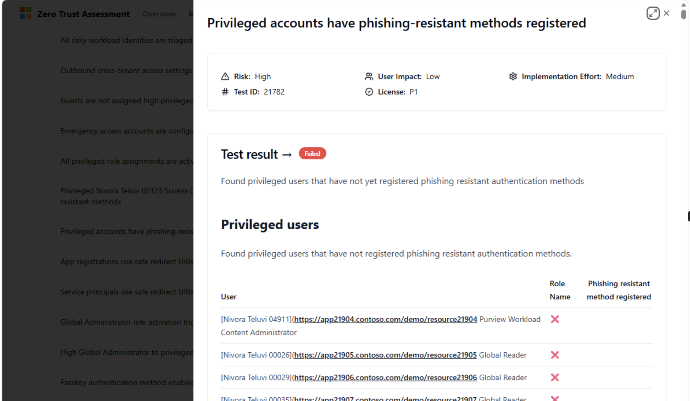

4. Review the finding's status, explanation, and supporting evidence.

5. Identify what the result shows about registration and which sign-in evidence you would need to check enforcement.

6. Select **Devices**.

7. Locate **Update policies are enforced to reduce risk from unpatched vulnerabilities**.
   Open its details. Sample product names may be obfuscated, such as **Suvexa 03261** before this title.

    This policy check is **Passed**. Installation and restart results are still needed to check the 14-day objective.

    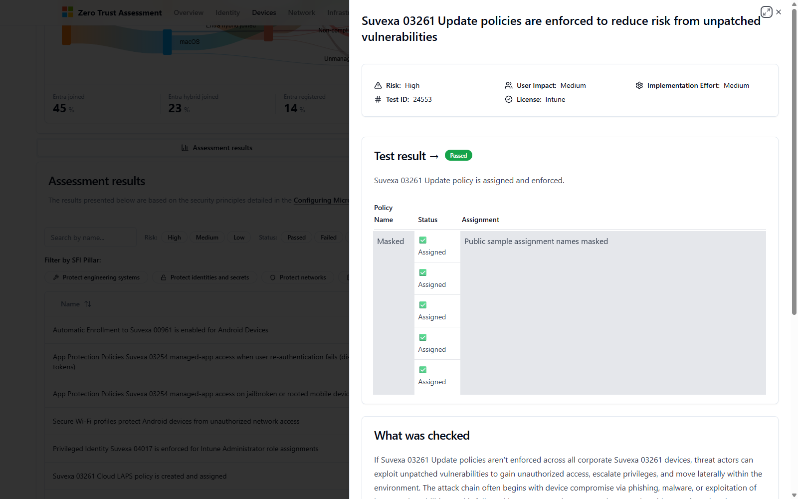

8. Review whether the evidence covers:
    - Policy configuration.
    - Policy assignment.
    - Update installation results.

9. Identify what is missing to check the **14-day patching objective**.

10. Decide which improvement you would address first.
    Consider affected accounts or devices, potential exposure, and evidence still needed.

11. Return to the **Zero Trust Workshop** tab.

12. Navigate to the task for that improvement:
    - **Identity > Rollout Conditional Access with Authentication Strength controls**, or
    - **Devices > Update Rings**.

13. Select **View details**.
    Review the guidance, then return to the **Zero Trust Workshop** tab.

14. Set **Status** to **In Planning**.

15. In **Notes**, describe what both assessment results show. You can also explain which improvement you would address first and why, and what additional evidence you need.

16. Select **Save**.

17. Reopen the task to confirm your notes and **In Planning** status were saved.

**Explore further:** You can explore the Workshop's other pillars and guidance on your own before continuing to Section 3 of this lab.

===

## Section 3 - Identity: phishing-resistant authentication and risky or dormant access

A compromised account gives an attacker the access and permissions of that identity. AI tools and agents can make that access faster to exploit, including finding sensitive data or taking actions on the account's behalf.

Phishing-resistant MFA helps prevent takeover. A user-risk policy requires remediation when an account is likely compromised, while sign-in activity helps identify dormant accounts that retain unnecessary access.

The following exercise combines **Phishing-resistant MFA** with remediation for high-risk users, supporting the Workshop task **Rollout Conditional Access with Authentication Strength controls**. Keep the policy **Report-only** and scoped to the empty pilot group.

### Create a scoped report-only policy

References: <[Conditional Access with phishing-resistant MFA](https://learn.microsoft.com/en-us/entra/identity/conditional-access/policy-admin-phish-resistant-mfa) and <[Require remediation for risky users](https://learn.microsoft.com/en-us/entra/identity/conditional-access/policy-risk-based-user).

Use an **empty pilot security group** and **Report-only** mode to practice configuring the policy without affecting sign-ins.

1. Sign in to the **Microsoft Entra admin center** with your **Cloud Admin** account:
   +++https://entra.microsoft.com/+++.

    **Username:** ++@lab.CloudCredential(PromoCode).AdministrativeUsername++
    
    **Temporary Access Pass: +++@lab.Variable(TAP)+++**

    **Password:** +++@lab.CloudCredential(PromoCode).AdministrativePassword+++

2. Navigate to:
   **Entra ID > Groups > All groups**.

3. Select **New group**.

4. Enter the following group settings:

    - **Group type:** Security
    - **Group name:** +++ZT-Lab-PhishingResistant-Pilot+++
    - **Membership type:** Assigned
    - **Members:** Leave empty.
    - **Microsoft Entra roles can be assigned to the group:** **No**, if displayed.

    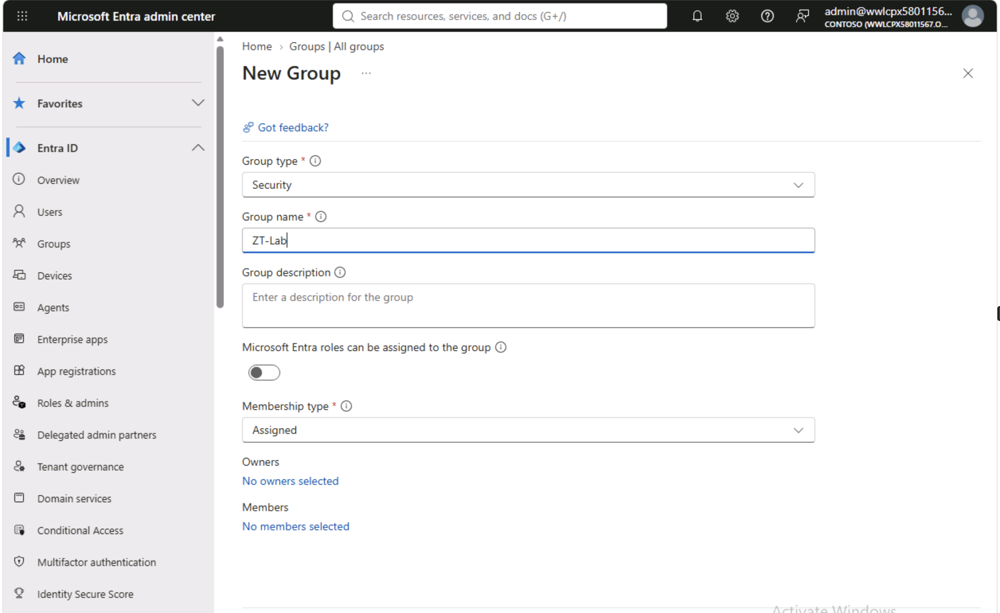

5. Select **Create**.

6. Open the saved group. Confirm **Assigned** membership, **no members**, and no role assignment.

    

7. Navigate to:
   **Entra ID > Conditional Access > Policies**.

8. Select **New policy**.

9. Name the policy:
    +++ZT-Lab-Require-Phishing-Resistant-MFA+++

10. Go to **Assignments > Users or agents**.
    Under **What does this policy apply to?**, retain **Users and groups**.

11. Under **Include**, select:
    **Select users and groups > Users and groups**.

12. Under **Select**, open the group picker, search for and select only:
    `ZT-Lab-PhishingResistant-Pilot`.
    Select **Select** to confirm the picker.

13. Go to **Target resources > Resources (formerly cloud apps)**.
    Select **All resources (formerly 'All cloud apps')**.

    **All resources** covers resources, not additional users. Only the pilot group should be included.

    

14. Under **Conditions > User risk**, set **Configure** to **Yes**, select **High**, and select **Done**.
    Then go to **Access controls > Grant**.

15. Select **Grant access**.

16. Select **Require risk remediation**.
    **Require authentication strength** is selected automatically.

17. Choose **Phishing-resistant MFA**.
    Leave the separate **Require multifactor authentication** checkbox unchecked.

18. Select **Select** to save the grant settings.

    Under **Session**, **Sign-in frequency > Every time** is applied automatically and is required for risk remediation.

    The image below shows both required Grant controls.

    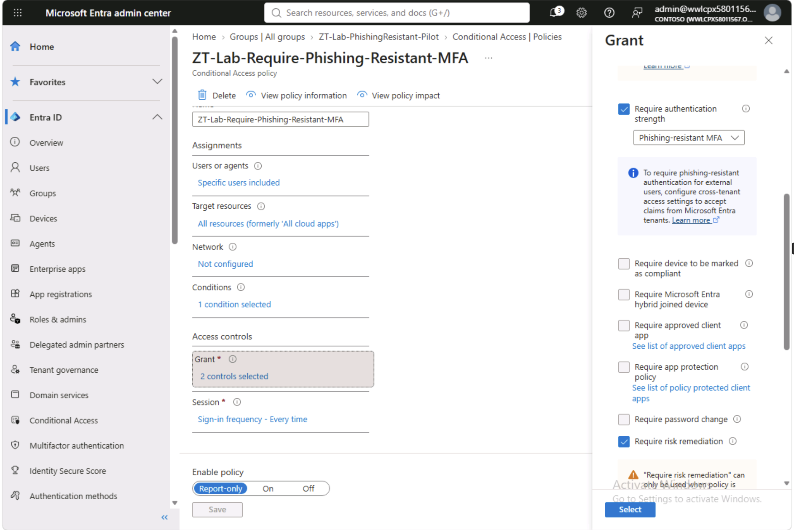

19. Under **Enable policy**, select **Report-only**.
    Do not select **On**.

    > [!Important] For this lab, keep the pilot group empty and the policy **Report-only** to avoid affecting the lab environment.
    >
    > In your own tenant, verify the settings and <[review report-only results](https://learn.microsoft.com/en-us/entra/identity/conditional-access/concept-conditional-access-report-only#reviewing-results) before changing **Enable policy** to **On**.
    >

20. Review the configuration:
    - **Users:** Only the empty `ZT-Lab-PhishingResistant-Pilot` group.
    - **Target resources:** **All resources**.
    - **User risk:** **High**.
    - **Grant:** **Require risk remediation** and **Require authentication strength > Phishing-resistant MFA**.
    - **Sign-in frequency:** **Every time**.
    - **Enable policy:** **Report-only**.

21. Select **Create**.

22. Open the saved policy.
    In **Policy details**, confirm **Report-only**, one selected group, and **All resources**.
    Select **View or Edit** to verify the pilot group, **High** user risk, **Grant** settings, and **Every time** sign-in frequency, then close without saving changes.
    If the page stays blank, ask the proctor to reopen it in a fresh tab. Do not create a duplicate.

    

23. Return to the **Zero Trust Workshop** tab.

24. Navigate to:
    **Identity > Rollout Conditional Access with Authentication Strength controls**.

25. Set **Status** to **In Planning**.

26. Add the policy name, verified settings, and remaining rollout steps to **Notes**. Keep your assessment observations. If creation was blocked, record that instead.

    Before enforcement, prepare authentication methods and emergency-access exclusions, add pilot users, and <[review report-only results](https://learn.microsoft.com/en-us/entra/identity/conditional-access/concept-conditional-access-report-only#reviewing-results).

27. Select **Save**.

28. Reopen the task to confirm your notes and status were saved.

> [!Note] Phishing-resistant methods include passkeys (FIDO2) and Windows Hello for Business. Authenticator push approval or number matching alone does not meet this authentication strength.

**Key takeaway:** Phishing-resistant MFA helps prevent account takeover. User-risk remediation addresses likely compromise, while removing dormant access closes access paths that are no longer needed. Use the Workshop to plan these complementary protections.

===

## Section 4 - Devices: plan update rings and timely updates

An unpatched device can give an attacker a foothold in your environment, including access to AI tools and the data available on that device. Timely updates reduce exposure to known vulnerabilities.

The following exercise supports the Workshop's **Update Rings** task and a **14-day quality-update objective**. You will create:

- A **Windows update ring** for installation behavior, deadlines, and grace.
- A **Windows Autopatch quality update policy** for approval, availability, and hotpatch.

<[Windows Autopatch](https://learn.microsoft.com/en-us/windows/deployment/windows-autopatch/overview/windows-autopatch-overview) can automate staged rollout using Autopatch-managed rings, with a separate quality update policy for hotpatch. This lab creates the policies manually to introduce their settings. Keep **both policies unassigned** for this lab.

> [!Important] Do not start device enrollment or Autopatch-group onboarding.

### Create an unassigned Windows update ring

For devices already in <[Autopatch groups](https://learn.microsoft.com/en-us/windows/deployment/windows-autopatch/deploy/windows-autopatch-groups-overview), manage rings through the group rather than adding this lab ring.

References: <[Create update rings](https://learn.microsoft.com/en-us/intune/device-updates/windows/manage-update-rings) and <[Update ring settings](https://learn.microsoft.com/en-us/intune/device-updates/windows/ref-update-ring-settings).

1. Sign in to the **Microsoft Intune admin center** with your **Cloud Admin** account:
   +++https://intune.microsoft.com/+++.

    **Username:** ++@lab.CloudCredential(PromoCode).AdministrativeUsername++

    **Temporary Access Pass: +++@lab.Variable(TAP)+++**

    **Password:** +++@lab.CloudCredential(PromoCode).AdministrativePassword+++

2. Navigate to:
   **Devices > By platform > Windows > Manage updates > Windows updates**.
   
3. Select the **Update rings** tab.

4. Select **Create profile**.
    On an empty list, **Create update ring policy** is an alternative entry point.

    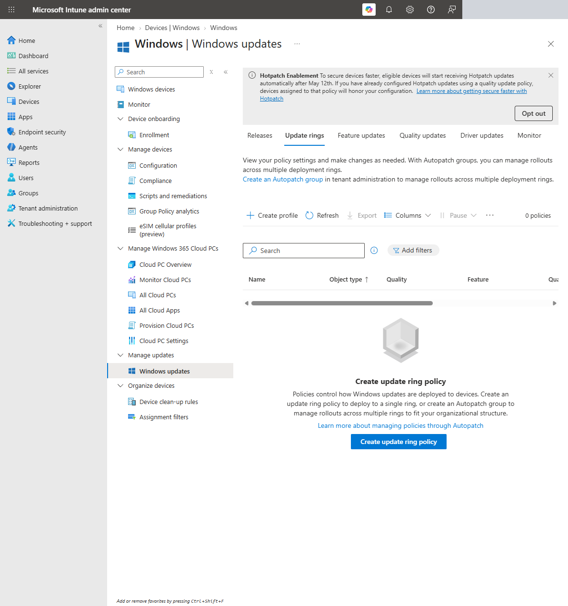

5. Under **Basics**, enter:

    - **Name:** +++ZT-Lab-Windows-Update-Ring+++
    - **Description:** +++Pilot settings for a 14-day quality-update objective.+++

6. Select **Next**.

7. Under **Update ring settings**, set:
    - **Quality update deferral (days):** `0`.
    - **Feature update deferral (days):** `0`.
    - **Upgrade Windows 10 to Windows 11:** **No**.

8. Set **Automatic update behavior** to:
   **Auto install at maintenance time**.

9. Set the active hours:
    - **Active hours start:** `8 AM` / `08:00`
    - **Active hours end:** `5 PM` / `17:00`

    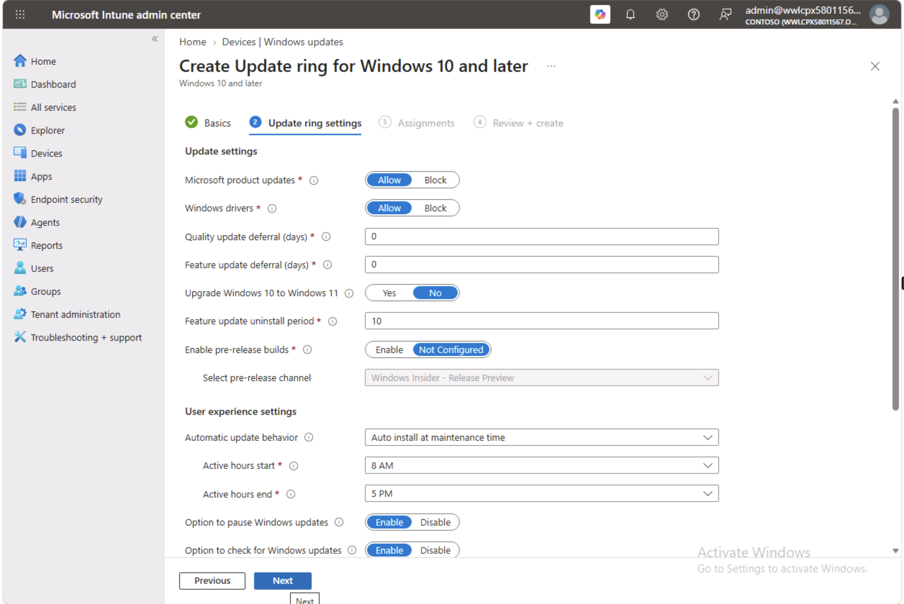

10. Set **Use deadline settings** to **Allow**.

11. Enter the deadline and restart settings:
    - **Deadline for quality updates:** `7` days.
    - **Deadline for feature updates:** `14` days.
    - **Grace period:** `2` days.
    - **Auto reboot before deadline:** **Yes**.

    

12. Leave all other settings at their displayed defaults.
    Select **Next**.

13. On **Assignments**, leave all group assignments empty.
    This wizard has no **Scope tags** page.

    > [!Note] Do not add groups, **All users**, or **All devices**. Leave this ring unassigned for the lab.

14. Select **Next**.

15. Select **Create**.

16. Open the saved `ZT-Lab-Windows-Update-Ring`.

17. Scroll to **Properties**. Confirm the settings match steps 7-11 and that included and excluded groups are both empty.

    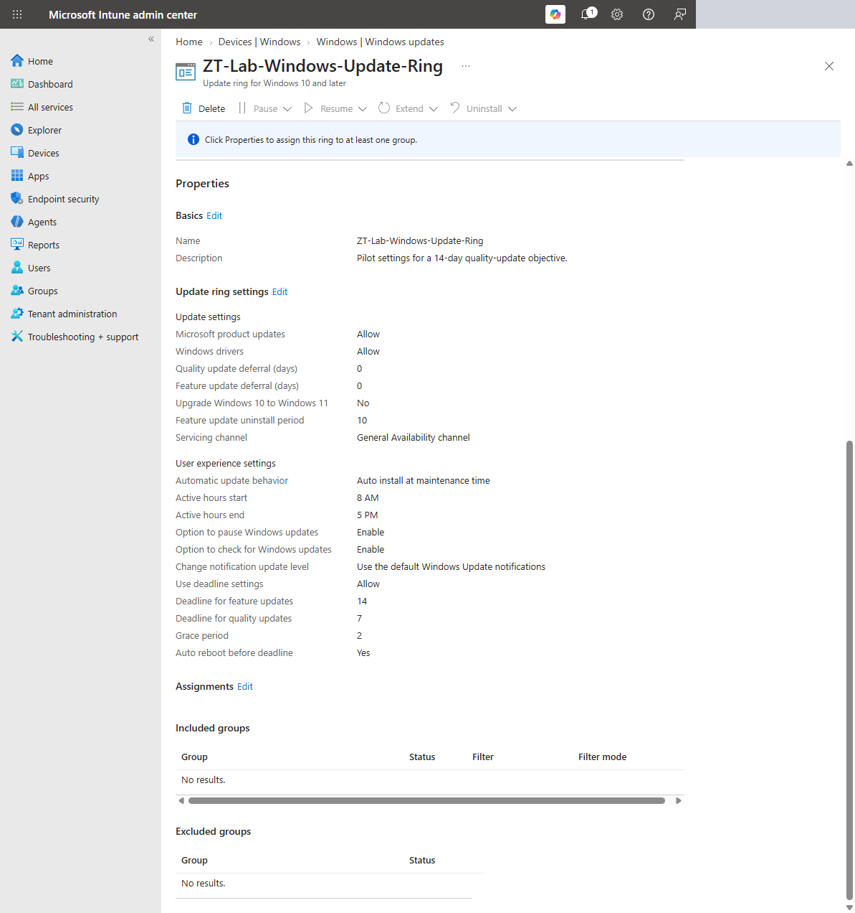

### Allow hotpatch in a separate Windows Autopatch quality update policy

Hotpatch installs eligible Windows security updates without restarting the device, so protection does not have to wait for a convenient restart. Periodic baseline updates still require restarts.

You enable hotpatch through a quality update policy alongside your update rings, including Autopatch-managed rings. The quality policy controls which updates are approved and when they become available. That timing overrides ring deferral, while ring deadlines and grace periods still apply.

Devices must meet the <[hotpatch prerequisites](https://learn.microsoft.com/windows/deployment/windows-autopatch/manage/windows-autopatch-hotpatch-updates) before deployment.

Reference: <[Windows quality update policies](https://learn.microsoft.com/windows/deployment/windows-autopatch/manage/windows-autopatch-windows-quality-update-overview).

1. Return to **Windows updates**.

2. Select **Quality updates**.

3. Select **Create > Windows quality update policy**.

4. On **Basics**, enter:
    - **Name:** +++ZT-Lab-Autopatch-Hotpatch+++
    - **Description:** Leave blank.

5. Select **Next**.

6. On **Update settings**, verify:
    - **Monthly B week updates:** **Automatically approve**, available after `0` days.
    - **Monthly D week preview updates:** **Manually review and approve**.
    - **Out-of-band security updates:** **Manually review and approve**.
    - **Out-of-band non-security updates:** **Manually review and approve**.
    - **Quick machine recovery updates:** **Manually review and approve**.

7. Under **Automatic update deployment settings**, set the control for **For monthly B-week security updates, when available, apply without restarting the device ("hotpatch")** to **Allow**.
    If Allow is already selected, retain it.

    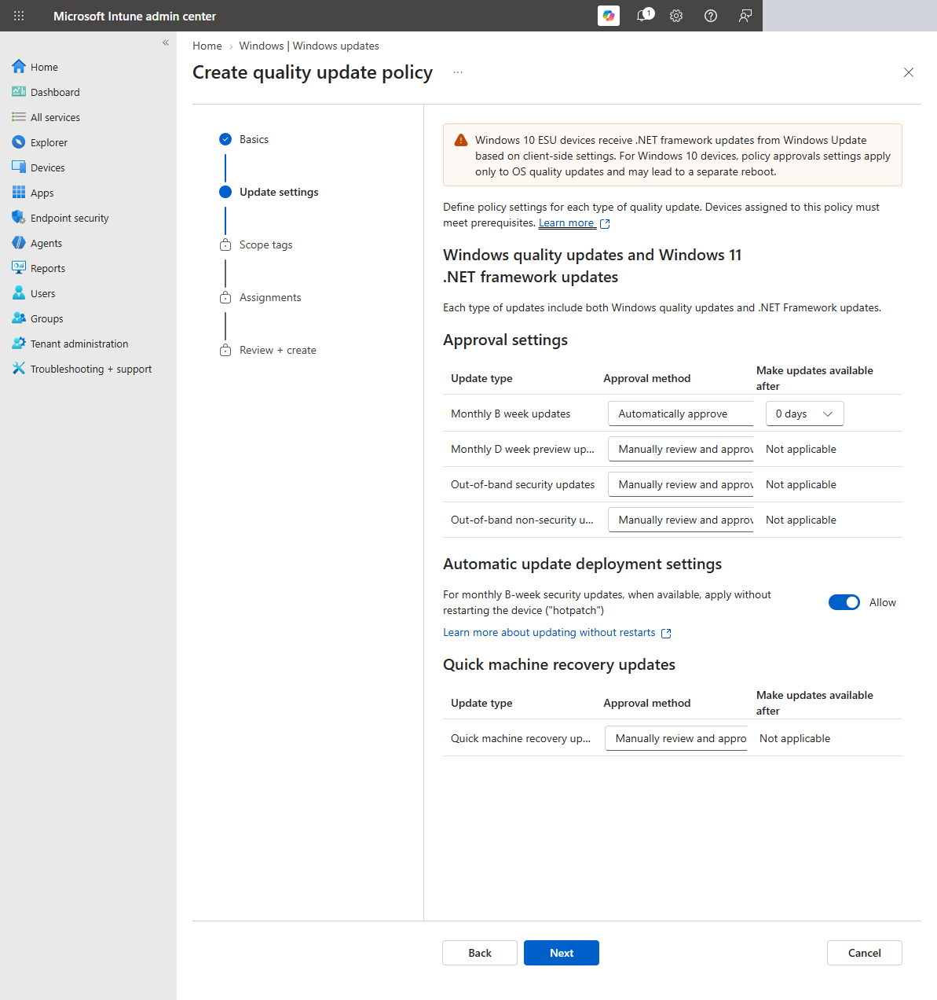

8. Select **Next**.

9. On **Scope tags**, retain **Default**, then select **Next**.

10. On **Assignments**, add no groups, **All users**, or **All devices**.
    Select **Next**.

11. On **Review + create**, confirm the name, approval settings, **Hotpatch Allow**, and **no assignments**.
    Select **Create**.

12. Reopen `ZT-Lab-Autopatch-Hotpatch` from **Quality updates**.
    The list should show **Hotpatch Enabled: Yes** and **Assigned: No**.

    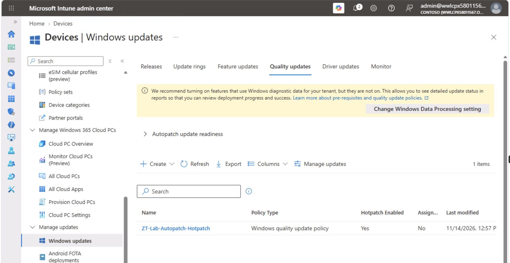

13. In saved **Properties**, confirm the approval settings, hotpatch **Allow**, **Default** scope tag, and empty included/excluded groups.
    Do not select **Edit** or assign devices.

    

### Update the Workshop task with both device configurations

1. Return to the **Zero Trust Workshop** tab.

2. Navigate to:
    **Devices > Update Rings**.

3. Set **Status** to **In Planning**.

4. Add both policy names, verified settings, and any blockers to **Notes**. Keep your assessment observations.

    You can also capture next steps:
    - Check hotpatch eligibility.
    - Plan a pilot using either directly managed rings or Autopatch groups, with a quality update policy for hotpatch.
    - Compare release dates with installation and restart results, including offline and overdue devices.

5. Select **Save**.

6. Reopen the task to confirm your notes and status were saved.

**Key takeaway:** Update rings control rollout timing and restart behavior. Autopatch can automate staged deployment, while hotpatch applies eligible security updates without a restart. Use the Workshop to plan your update approach, then measure installed updates and restart results against the 14-day objective.

===

## Section 5 - AI: review agent inventory, ownership, and access

**Instructor-led demonstration; review only.** Follow the instructor's walkthrough. If you are working at your own pace, review the explanations and screenshots below instead. No tenant changes are required.

AI agents can retrieve information and perform actions using their own permissions or a signed-in user's delegated access. As organizations adopt more agents, they need visibility into which agents are in use, who owns them, and what they can access.

The Agent 365 registry in the Microsoft 365 admin center brings agent information together. The example below shows how agent details, connected tools, and activity support this review.

### Inventory, ownership, and access

- **Inventory:** Record agents and their business purpose so they can be managed throughout their lifecycle.
- **Ownership:** Assign an accountable owner responsible for the agent's use and ongoing review.
- **Access:** Apply least privilege so the agent has only the permissions needed for its work.

Ownership continues after deployment. Changes to tools, knowledge sources, or permissions need review, and agents that are no longer needed should be retired.

### Example - Contract Policy Expert

**Contract Policy Expert** answers contract-policy questions. Its **Details** pane shows the description, publisher, and owner. The publisher identifies who supplied the agent; the owner is accountable for its use.

The agent's purpose guides the permissions review. Answering questions about policies may require reading policy documents, but does not automatically require editing them or sending messages.

**Data & tools** shows the configured knowledge source, retrieval tool, and contract-policy skill. Knowledge sources provide information for answers. Tools provide capabilities, such as retrieving content or performing an action.

Together, these details explain how the agent carries out its work and which connections need an access review.

**Activity** shows active users, sessions, exceptions, and trends. These metrics help identify adoption, changes in usage, and operational issues that may need investigation.

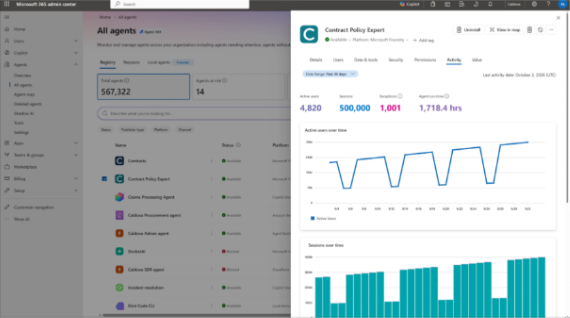

### Understand agent permissions

The identity used for each operation determines which permissions apply:

- **Delegated access:** The agent acts on a signed-in person's behalf. Access is limited by that person's permissions and the delegated scopes granted for the operation.
- **Application access:** The agent uses permissions assigned to its own identity, without requiring a signed-in person. Those permissions need review independently of user access.

An agent can use different access patterns for different operations. A permissions review considers both the allowed actions, such as read or write, and the resources those actions apply to.

The screenshots show configuration and usage, not a permissions review or an access test. They do not establish whether this agent has excess access or whether its answers are correct.

The <[Workshop's AI security guidance](https://learn.microsoft.com/en-us/security/zero-trust/workshop-zero-trust-ai-security) connects inventory and agent registration with ownership, access controls, and continuous monitoring. These are ongoing responsibilities as agents and their capabilities change.

**Key takeaway:** Know the agent's job, identify its owner, and verify that its access matches its purpose.

### Learn more

- <[Agent registry](https://learn.microsoft.com/en-us/microsoft-agent-365/admin/agent-registry-overview)
- <[Agent details and permissions](https://learn.microsoft.com/en-us/microsoft-agent-365/admin/agent-details#agent-permissions)
- <[Agent access: its own identity or a person's behalf](https://learn.microsoft.com/en-us/microsoft-agent-365/guidance/agent-authority)
- <[Microsoft Agent 365 overview](https://learn.microsoft.com/en-us/microsoft-agent-365/overview)

===

## Section 6 - Data: review classification and protection

**Instructor-led demonstration; review only.** Follow the instructor's walkthrough. If you are working at your own pace, review the explanations and screenshots below instead. No tenant changes are required.

Microsoft 365 Copilot uses information that a user is permitted to access. If sensitive content is shared too broadly, Copilot can make that content easier to discover and use.

Microsoft Purview Data Security Posture Management (DSPM) helps identify potential oversharing and recommends actions to reduce it. The example below follows a finding from assessment results to sharing and protection options.

### Classification and protection

- **Sensitivity labels** classify content according to its sensitivity and handling requirements. Depending on their configuration, labels can also apply protection such as encryption.
- **Sharing permissions** determine who can access a file or site.
- **Encryption** can restrict who can open content and what they can do with it.
- **Data Loss Prevention (DLP)** policies can restrict the use of labeled content in supported Copilot and agent experiences.

A label name such as **Confidential** does not explain all the protections applied to a file. Access depends on the sharing permissions and the label's configured protection settings.

### Example - Review access to a classified file

**SP Oversharing Assessment** shows approximately 23.2K unlabeled items and 101 potentially overshared items. The first count helps identify content that may need classification. The second highlights content whose audience may be broader than intended.

These are findings within the assessment's scope, not confirmation that every unlabeled item is sensitive or that a data leak occurred.

**Test document for labeling.docx** has a **Confidential/All employees** label and an **Everyone** sharing link flagged for review. The label identifies the classification, while the link provides a way to access the file.

An appropriate response depends on the link's actual audience, the business need for sharing, and any encryption applied. The displayed **Everyone** text alone does not establish anonymous access.

The site's **Protect** tab provides guidance to **Exclude Copilot and agents from processing** through a label-based DLP policy. This can restrict AI processing of selected content while leaving file access governed by its existing permissions and protection.

The <[review-actions view](instructions359866/17b-dspm-review-actions.png) includes an option to remove a sharing link. Removing that link closes one access path. Access granted through groups, other links, or direct permissions needs separate consideration.

### Match protection to the finding

- **Classification gaps** call for an appropriate label based on the content and handling requirements.
- **Oversharing** calls for correcting permissions or links that grant unnecessary access.
- **Restrictions on AI use** call for an applicable DLP policy, rather than assuming a label alone excludes content from processing.

These controls can work together. In a deployment, testing checks that intended users retain access, unintended users cannot access the content, and Copilot processing follows the configured policy. This example shows findings and available guidance, not applied sharing changes, verified encryption, or a tested DLP policy.

The Workshop guidance follows the same progression: <[Define the taxonomy](https://microsoft.github.io/zerotrustassessment/docs/workshop-guidance/data/RMT_006), <[manually classify sensitive assets](https://microsoft.github.io/zerotrustassessment/docs/workshop-guidance/data/RMT_008), then <[protect critical assets](https://microsoft.github.io/zerotrustassessment/docs/workshop-guidance/data/RMT_025). The classification pilot starts without usage restrictions. Protection is planned separately.

**Key takeaway:** Before expanding Copilot, classify sensitive data, confirm who can access it, and verify its protection.

### Learn more

- <[DSPM data risk assessments and remediation](https://learn.microsoft.com/en-us/purview/data-security-posture-management-oversharing)
- <[Sensitivity labels](https://learn.microsoft.com/en-us/purview/sensitivity-labels)
- <[Apply encryption using sensitivity labels](https://learn.microsoft.com/en-us/purview/encryption-sensitivity-labels)
- <[Copilot permissions, labels, and encryption](https://learn.microsoft.com/en-us/copilot/plan/architecture-data-protection-auditing)
- <[Secure data with Zero Trust](https://learn.microsoft.com/en-us/security/zero-trust/deploy/data)

===

## Section 7 - Review your Workshop action plan

Your Workshop Progress Report brings the task statuses and notes from this lab together. Use it alongside the sample assessment results to review findings and plan next steps.

1. Return to your **Zero Trust Workshop** tab.

2. Open each of the following tasks:
    - **Identity > Rollout Conditional Access with Authentication Strength controls**.
    - **Devices > Update Rings**.

3. Keep both tasks **In Planning** while testing and rollout remain. Save any changes to your notes.

4. Select **Actions > Report**.
   Allow the report to open in a new tab.

    

5. Under **Filter by Pillar**, select **Identity**. Use the overview screenshot below as a reference for steps 6-8.

6. Go to **Implementation Roadmap**.
   Compare its recommendations with your next steps. Timeframes are planning guidance, not deployment commitments.

    Expand the relevant pillar row within a timeframe to see individual tasks. In this example, the Identity task appears under **30 Days**, and **Update Rings** appears under **Immediate**.

7. Go to **Task Summary (Reviewed tasks)**.
   Review completion totals and breakdowns by pillar and functional area. Individual tasks appear under **Workshop Notes**.

8. Review **Status Distribution**.
   The report shows **In Planning** tasks as **Planned**, not completed.

    The Identity overview below shows all three areas: **Implementation Roadmap**, **Task Summary**, and **Status Distribution**. Use the expanded roadmap row or Workshop Notes for individual task details.

    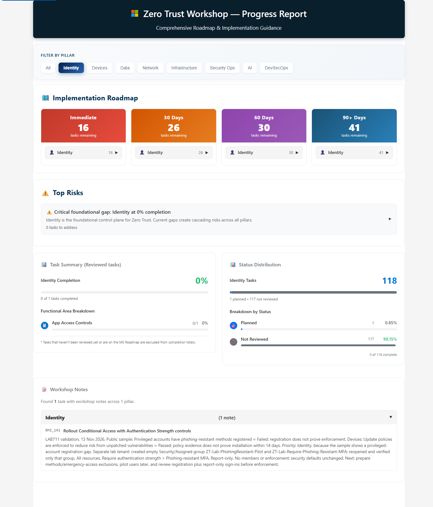

    Select **Devices** under **Filter by Pillar** and review the same three areas. The **Update Rings** task's note covers both device policies. Then select **All** for a combined report.

9. Go to **Workshop Notes**.
   Expand the relevant pillar row to find:
    - **Rollout Conditional Access with Authentication Strength controls (RMI_141)**.
    - **Update Rings (DEV-092)**.

    Under **All**, expand both rows to review the notes you saved.

    For larger individual examples, open the <[Identity configuration note](instructions359866/19c-identity-configuration-note.png) or <[Devices configuration note](instructions359866/19d-devices-configuration-note.png).

    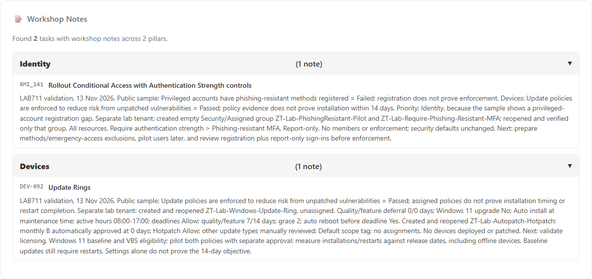

10. Choose one improvement to take back to your organization. Its owner, target date, and measures of progress can be agreed with the relevant stakeholders.

> [!Note] The report may include unreviewed recommendations. Its percentages and **Top Risks** summarize Workshop planning data, not a live tenant assessment.

===

## Section 8 - Review and next steps

### Review

Review how the lab's activities support your Zero Trust roadmap and secure AI adoption:

| Deployment area | What you practiced or reviewed | Implementation next step |
|---|---|---|
| Phishing-resistant authentication | Created a scoped, report-only authentication policy. | Prepare methods and test with a pilot group. |
| Remove risky and dormant access | Added user-risk remediation to the authentication policy and reviewed how sign-in activity identifies dormant accounts. | Pilot risk remediation and remove access that is no longer needed. |
| Patch devices within 14 days | Created an unassigned update ring and quality update policy with hotpatch allowed. | Check eligibility, pilot both policies, and measure installation and restarts. |
| Inventory agents, owners, and access | Reviewed agent details, configured tools, and usage. | Confirm accountable owners and check permissions against access to resources. |
| Classify and protect data | Reviewed potential oversharing of a labeled file and DLP options for Copilot. | Confirm effective access and test appropriate protection. |

**Continue your Zero Trust journey:** Assess your environment, prioritize improvements with **First**, **Then**, and **Next**, and agree on actions, owners, and target dates. Reassess and use deployment results to measure progress.

**End of lab**

---

## Additional resources

- <[Zero Trust Assessment demo](https://microsoft.github.io/zerotrustassessment/demo/).
- <[Zero Trust Workshop](https://zerotrust.microsoft.com/).
- <[Microsoft Zero Trust guidance](https://learn.microsoft.com/en-us/security/zero-trust/).
- <[Microsoft Zero Trust overview](https://learn.microsoft.com/en-us/security/zero-trust/zero-trust-overview).