# Build an AI-Ready Secure Foundation with Zero Trust

**Draft participant guide - Ignite 2026**

AI is transforming how people work, but secure adoption starts with a strong foundation. Apply Microsoft's Zero Trust principles to strengthen access controls, reduce risk, and protect sensitive information.

Use the Zero Trust Assessment to identify and prioritize security findings. Then use the Workshop to plan a secure foundation across identities, devices, applications, infrastructure, networks, and data.

### Lab Overview

Investigate security findings, configure scoped identity and device policies, and review examples of agent access and data protection. Record your findings and next steps in the Zero Trust Workshop, then use its Progress Report to review your plan.

| Sections | Your activity |
|---|---|
| 1-2 | Investigate two sample Assessment findings, prioritize one, and save your reasoning in the Workshop. |
| 3 | Review risky and dormant access, then create an empty pilot group and a Report-only policy for phishing-resistant authentication. |
| 4 | Create an unassigned Windows update ring and a separate Windows Autopatch quality update policy with hotpatch allowed. |
| 5-6 | Review agent ownership, permissions, data classification, sharing, and protection options. No configuration or Workshop entries are required. |
| 7-8 | Review your saved plan, choose an organizational next step, and confirm the lab's safe-exit settings. |

The configuration exercises prepare policies without enforcing them or deploying updates. Keep the identity policy in **Report-only**, the pilot group empty, and both device policies **unassigned**.

### Before You Begin

> [!Alert] Complete the exercises in a lab or test tenant, not a production tenant.

1. If you are using the supplied lab environment, sign in to the **lab VM**:

    **Username:** ++@lab.VirtualMachine(Win11-Pro-Base-VM).Username++

    **Password:** +++@lab.VirtualMachine(Win11-Pro-Base-VM).Password+++

    If you are using a dedicated test tenant, sign in with its test account on your lab device.

2. Open **Microsoft Edge**.

3. Navigate to the **Zero Trust Workshop**:
   <[Zero Trust Workshop](https://zerotrust.microsoft.com/).

Keep the Workshop open in the same browser profile throughout the lab so your notes are available in the final report. Notes and status overrides are stored locally in that browser profile; saving them does not establish cross-device persistence or retention after a temporary lab expires.

===

## Section 1 - Zero Trust, the Assessment, and the Workshop

<[Microsoft Zero Trust](https://learn.microsoft.com/en-us/security/zero-trust/zero-trust-overview) continuously verifies access using identity, device, location, behavior, and risk signals, granting only the access needed.

AI assistants and agents use identities and permissions to access organizational data. Before expanding AI use, identify the access you need to protect and the gaps you need to address.

Microsoft's Zero Trust approach uses three principles:

| Principle | Connection to this lab |
|---|---|
| Verify explicitly | Evaluate identity, authentication, device posture, and other available signals before granting access. |
| Use least privilege access | Limit user and agent permissions, review unnecessary access, and identify accountable owners. |
| Assume breach | Limit what a compromised identity or device can reach, protect sensitive data, and monitor for threats. |

**Business enablement is the purpose:** Align these principles with the organization's mission, priorities, risks, and processes; it is not a fourth principle.

### Understand the Tools

**Find a gap, plan a response, and decide how to check it.** Use the three tools in this order:

1. **Find a gap in the Assessment.**
   Open the <[prepared sample report](https://microsoft.github.io/zerotrustassessment/demo/) and explore its findings by pillar. For example, an Identity finding checks whether privileged accounts have phishing-resistant methods registered.

    The sample provides findings to investigate during this lab; changes in your tenant do not update its results. After the lab, you can <[run the assessment in your own environment](https://github.com/microsoft/zerotrustassessment).

    

2. **Plan a response in the Workshop.**
   Find the matching task. For the Identity example, use **Rollout Conditional Access with Authentication Strength controls**. Select **View details** to read the guidance, then return to the task editor.

    Set **Status** to **In Planning**, enter your proposed change and the evidence you need in **Notes**, and select **Save**. Keep the note within **1,000 characters**, retaining your assessment reasoning as you add configuration outcomes.

    Changes in a product portal do not automatically update the Workshop. Record the configurations you verify, any blockers, and the work that remains.

    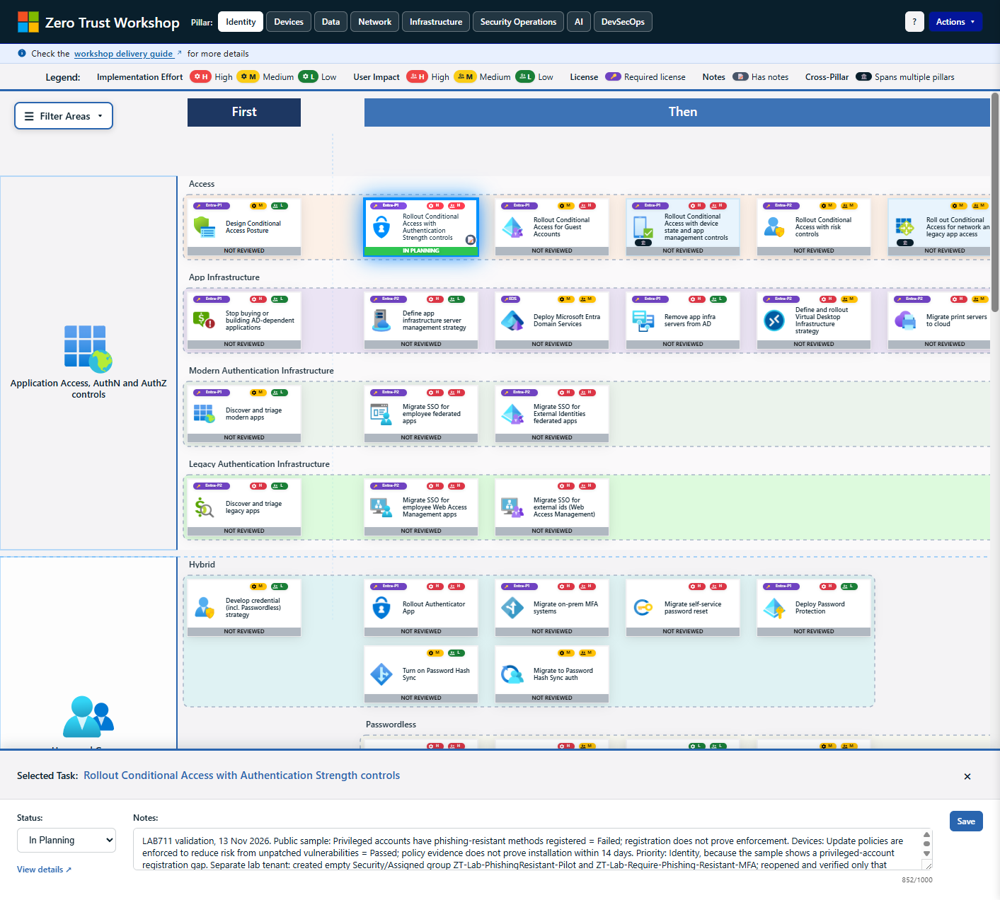

3. **Review your plan in the Progress Report.**
   Locate **Actions > Report** in the upper-right corner of the Workshop. In Section 7, use this menu to review your saved statuses, notes, and next steps together.

    The report tracks your plan, not deployed protection. Keep the task **In Planning** while pilot testing and rollout remain outstanding.

    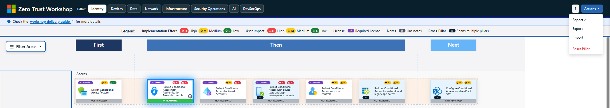

Next, review two findings, prioritize one, and record your reasoning in the Workshop.

===

## Section 2 - Assess the Critical Gaps

Review two findings. Note what each confirms and what remains unknown, then prioritize one.

1. Open the **prepared Zero Trust Assessment** in a new browser tab:
   <[Zero Trust Assessment sample report](https://microsoft.github.io/zerotrustassessment/demo/).

2. Select **Identity**.

3. Under **Assessment results**, select:
   **Privileged accounts have phishing-resistant methods registered**.

    

    The sample finding reports **Failed** for phishing-resistant method registration. Check sign-in evidence separately to determine whether phishing-resistant authentication is enforced.

4. Review the finding's status, explanation, and supporting evidence.

5. Record what the finding confirms about method registration.
   Note the additional evidence needed to verify sign-in enforcement.

6. Select **Devices**.

7. Locate **Update policies are enforced to reduce risk from unpatched vulnerabilities**.
   An obfuscated product prefix may precede the title; the sample report uses **Suvexa 03261**. Open its details.

    

    The sample report marks this policy check as **Passed**. You still need installation and restart results to determine whether devices meet the 14-day objective.

8. Review whether the evidence covers:
    - Policy configuration.
    - Policy assignment.
    - Update installation results.

9. Record the evidence still needed to evaluate the **14-day patching objective**.

10. Choose one finding to prioritize.
    Record your reason based on affected accounts or devices, potential exposure, and evidence gaps.

11. Return to the **Zero Trust Workshop** tab.

12. Navigate to the task matching your priority:
    - **Identity > Rollout Conditional Access with Authentication Strength controls**, or
    - **Devices > Update Rings**.

13. Select **View details**.
    Review the guidance, then return to the task.

    If the guidance tab does not open, use the matching link: <[authentication-strength guidance (RMI_141)](https://microsoft.github.io/zerotrustassessment/docs/workshop-guidance/identity/RMI_141) or <[Update Rings guidance (RMD_141)](https://microsoft.github.io/zerotrustassessment/docs/workshop-guidance/devices/RMD_141). The live Update Rings task ID is **DEV-092**, although its guidance URL uses **RMD_141**.

14. Set **Status** to **In Planning**.

15. In **Notes**, enter your observations, priority rationale, and follow-up evidence.
    Use the template below and stay within the **1,000-character limit**.

16. Select **Save**.

17. Reopen the task and confirm that the exact note and **In Planning** status were retained.

> [!Hint] Some product names are obfuscated in the sample report. Use the check's description and supporting evidence to identify the finding.

**Workshop note template**

```text
Identity: [finding, evidence, and its limits].
Devices: [finding, evidence, and its limits].
Priority: [which finding to address first and why].
Follow-up: [additional evidence needed].
```

### Check Your Work

Confirm your saved Workshop note includes both findings, the priority and rationale, and needed follow-up evidence. Keep it for adding policy details in Sections 3 and 4.

If tenant configuration is blocked later, record what remains uncompleted. Do not copy a "Created..." example as a completed result without creating and verifying that object.

===

## Section 3 - Phishing-Resistant Authentication; Remove Risky & Dormant Access

Review risky and dormant access, then configure a report-only Conditional Access policy for phishing-resistant authentication.

Authentication and access review address different questions: **How should this identity sign in?** and **Should it still have this access?**

### Review Risky and Dormant Access

In Entra, review risk detections and sign-in activity alongside the account's permissions. Check why the account needs access before deciding what to change.

Combine these signals rather than treating a risk flag or an old sign-in date as an automatic removal decision. Use the following example to practice the review; your lab tenant does not need populated risk or sign-in data. Do not remove access in this lab.

| Review checkpoint | What to look for | What it does not establish |
|---|---|---|
| Risk detections and sign-in context | What was detected, when it occurred, and the affected account and sign-in. | A detection alone does not determine the appropriate response. |
| Interactive and non-interactive activity | Whether the account is inactive across the relevant sign-in types. | No recent interactive sign-in alone does not prove the account is unused. |
| Permissions and resource-owner review | What the account can access, why it needs access, and who can confirm that need. | An old account or broad permission alone does not authorize removal. |

**Illustrative example:** An account has access to a sensitive application but no interactive sign-ins in 120 days. Before removing access, check non-interactive activity and confirm the account's purpose with the resource owner. A separate account has recent risk detections; review the detection details and sign-in context to decide how to respond.

For each account in the example, identify what you would investigate before deciding whether to retain or remove access.

### Create a Scoped Report-Only Policy

Reference: <[Conditional Access with phishing-resistant MFA](https://learn.microsoft.com/en-us/entra/identity/conditional-access/policy-admin-phish-resistant-mfa).

Use an **empty pilot security group** and **Report-only** mode to practice configuring the policy without affecting sign-ins.

1. Sign in to the **Microsoft Entra admin center** with your **Cloud Admin** account:
   <[Microsoft Entra admin center](https://entra.microsoft.com/).

    **Username:** ++@lab.CloudCredential(PromoCode).AdministrativeUsername++

    **Password:** +++@lab.CloudCredential(PromoCode).AdministrativePassword+++

2. Confirm the tenant name or domain.

    > [!Hint] If Conditional Access is unavailable, verify the tenant, account permissions, and licensing.

3. Navigate to:
   **Entra ID > Groups > All groups**.

4. Select **New group**.

5. Enter the following group settings:

    - **Group type:** Security
    - **Group name:** +++ZT-Lab-PhishingResistant-Pilot+++
    - **Membership type:** Assigned
    - **Members:** Leave empty.
    - **Microsoft Entra roles can be assigned to the group:** **No**, if displayed.

6. Select **Create**.

7. Open the saved group and confirm that it has **no members**.

    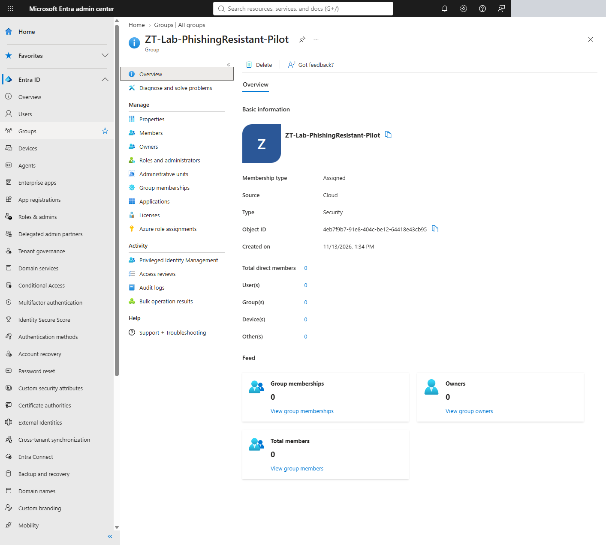

    Confirm that the group uses **Assigned** membership, contains no members, and is not enabled for role assignment. Keep it empty throughout the lab.

8. Navigate to:
   **Entra ID > Conditional Access > Policies**.

9. Select **New policy**.

10. Name the policy:
    +++ZT-Lab-Require-Phishing-Resistant-MFA+++

11. Go to **Assignments > Users or agents**.
    Under **What does this policy apply to?**, retain **Users and groups**.

12. Under **Include**, select:
    **Select users and groups > Users and groups**.

13. Under **Select**, open the group picker, search for and select only:
    `ZT-Lab-PhishingResistant-Pilot`.
    Select **Select** to confirm the picker.

14. Go to **Target resources > Resources (formerly cloud apps)**.
    Select **All resources (formerly 'All cloud apps')**.

    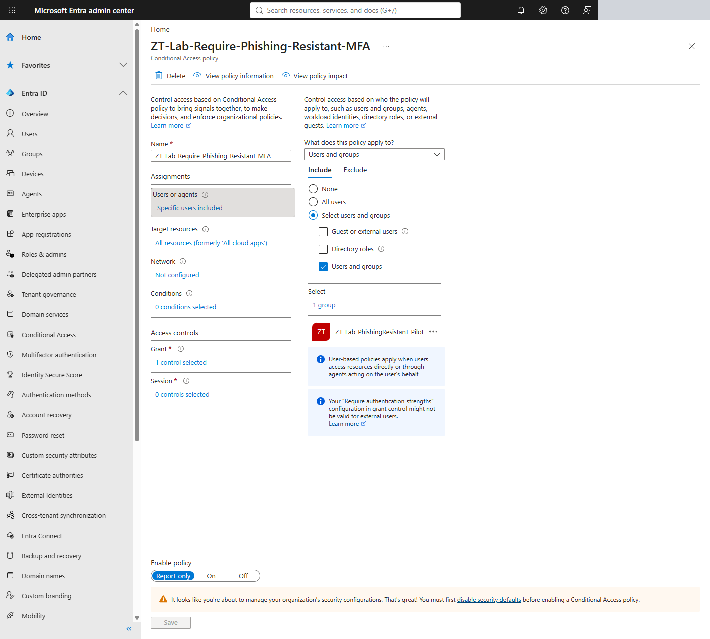

    Check that only the pilot group is included. Selecting **All resources** broadens resource coverage, not the users included in the policy.

15. Go to **Access controls > Grant**.

16. Select **Grant access**.

17. Select **Require authentication strength**.

18. Choose **Phishing-resistant MFA**.
    Leave the separate **Require multifactor authentication** checkbox unchecked.

19. Select **Select** to save the grant settings.

    

    Choose the built-in **Phishing-resistant MFA** authentication strength rather than the separate generic MFA control.

20. Under **Enable policy**, select **Report-only**.
    Do not select **On**.

    > [!Note] Leave the pilot group empty and the policy in **Report-only** mode for this lab.
    > Before a real rollout, prepare authentication methods and emergency-access exclusions, add pilot users, and <[review report-only results](https://learn.microsoft.com/en-us/entra/identity/conditional-access/concept-conditional-access-report-only#reviewing-results) before considering enforcement.
    > If a security-defaults notice appears, do not disable security defaults for this exercise. If creation is blocked, record the blocker and ask the proctor.

21. Review the configuration:
    - **Users:** Only the empty `ZT-Lab-PhishingResistant-Pilot` group.
    - **Target resources:** **All resources**.
    - **Grant:** **Require authentication strength > Phishing-resistant MFA**.
    - **Enable policy:** **Report-only**.

22. Select **Create**.

23. Open the saved policy.
    In **Policy details**, confirm **Report-only**, one selected group, and **All resources**.
    Select **View or Edit** to inspect the exact group and **Grant** settings; close the inspection without changing or saving settings.
    If the editor remains blank, ask the proctor to reopen the saved policy in a fresh tab. Do not create a duplicate.

    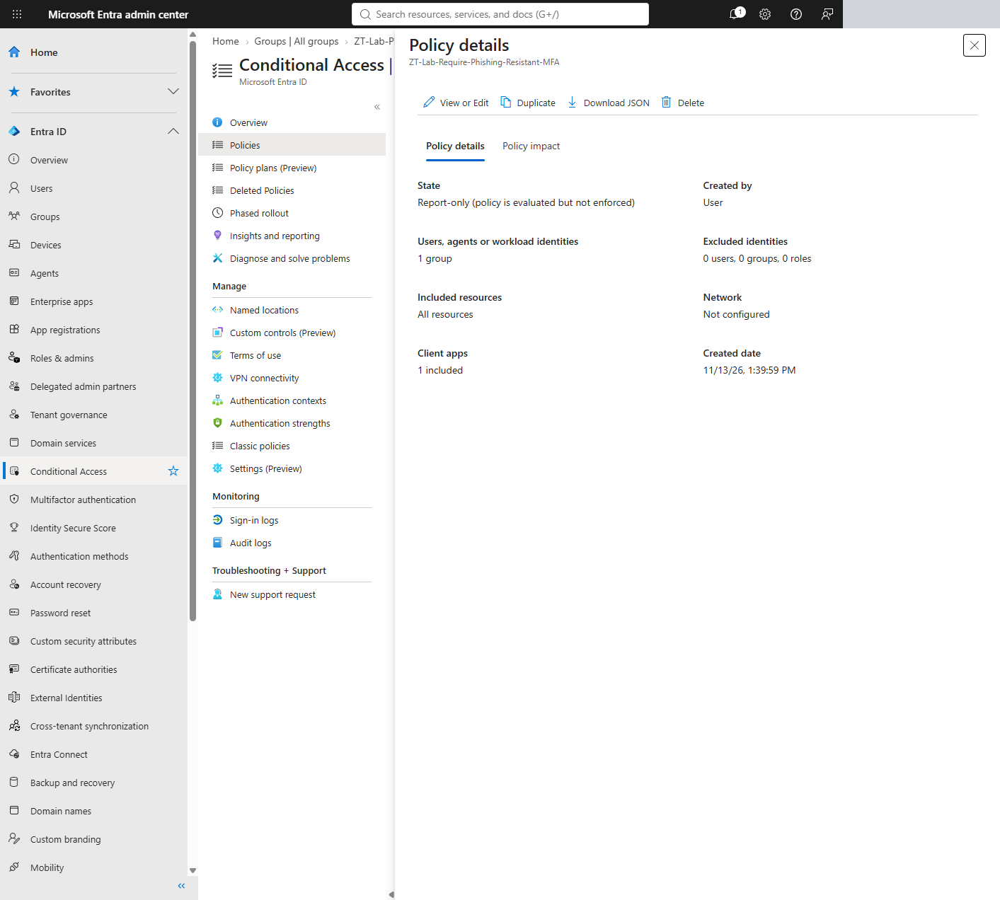

    Review the saved policy's **Report-only** state and confirm that it includes only the pilot group before continuing.

24. Return to the **Zero Trust Workshop** tab.

25. Navigate to:
    **Identity > Rollout Conditional Access with Authentication Strength controls**.

26. Set **Status** to **In Planning**.

27. In **Notes**, append the policy details and the checks needed before enforcement.
    Keep your existing assessment observations within the **1,000-character limit**. Use this example only after verifying the saved policy; otherwise record the blocker:

    ```text
    Created ZT-Lab-Require-Phishing-Resistant-MFA in Report-only mode,
    scoped to the empty pilot group.
    Next: Prepare methods and emergency-access exclusions, then add pilot
    users and review report-only sign-in results before enforcement.
    ```

28. Select **Save**.

29. Reopen the task and confirm your note and **In Planning** status were retained.

> [!Note] Phishing-resistant methods include passkeys (FIDO2) and Windows Hello for Business. Authenticator push approval or number matching alone does not meet this authentication strength.

### Check Your Work

Confirm the saved policy targets only the empty pilot group, covers **All resources**, requires the **Phishing-resistant MFA** authentication strength, and remains **Report-only**. Confirm your Workshop note is saved.

Keep the group empty and leave the policy in Report-only mode for the lab. With no members, there will be no sign-ins to evaluate against this policy. Leave the Workshop task **In Planning** because testing and rollout are still needed.

===

## Section 4 - Patch Devices Within 14 Days

Create a Windows update ring and a separate Windows Autopatch quality update policy with hotpatch allowed. The assessment check you reviewed examines update policies. To check whether devices meet the 14-day goal, you also need installation results.

Leave **both policies unassigned**. The ring configures update behavior, deadlines, and grace. The Windows Autopatch quality update policy configures cloud approval/availability and hotpatch. Hotpatch is not an update-ring setting. Its quality-update availability setting takes precedence over ring deferral; the ring's deadlines and grace still apply. Use `0` days in both places.

> [!Important] **Prerequisites and scope**
>
> Your lab tenant needs suitable administrative permissions, licensing, and access to both policy creation routes. If either is unavailable, record the blocker and ask the proctor rather than starting service onboarding. Device enrollment, Autopatch-group onboarding, and update installation are outside this lab's scope. Actual hotpatch deployment additionally requires eligible licensing, Intune-managed Windows 11 24H2 or later, a current baseline, and VBS running; check the current <[hotpatch prerequisites](https://learn.microsoft.com/windows/deployment/windows-autopatch/manage/windows-autopatch-hotpatch-updates). Baseline updates still require restarts; hotpatch does not mean "never reboot."

### Create an Unassigned Windows Update Ring

References: <[Create update rings](https://learn.microsoft.com/en-us/intune/device-updates/windows/manage-update-rings) and <[Update ring settings](https://learn.microsoft.com/en-us/intune/device-updates/windows/ref-update-ring-settings).

1. Sign in to the **Microsoft Intune admin center** with your **Cloud Admin** account:
   <[Microsoft Intune admin center](https://intune.microsoft.com/).

    **Username:** ++@lab.CloudCredential(PromoCode).AdministrativeUsername++

    **Password:** +++@lab.CloudCredential(PromoCode).AdministrativePassword+++

2. Confirm the tenant name or domain.

    > [!Hint] If Windows updates is unavailable, verify the tenant, account permissions, and Intune licensing.

3. Navigate to:
   **Devices > By platform > Windows > Manage updates > Windows updates**.

    > [!Hint] In some portal layouts, Windows updates appears directly under the Windows management menu. Select its **Update rings** page.

4. Select the **Update rings** tab.

5. Select **Create profile**.
    On an empty list, **Create update ring policy** is an alternative entry point.

    

    Start with **Update rings** for the installation and restart settings. You configure hotpatch separately under **Quality updates**.

6. Under **Basics**, enter:

    - **Name:** +++ZT-Lab-Windows-Update-Ring+++
    - **Description:** +++Pilot settings for a 14-day quality-update objective.+++

7. Select **Next**.

8. Under **Update ring settings**, set:
    - **Quality update deferral (days):** `0`.
    - **Feature update deferral (days):** `0`.
    - **Upgrade Windows 10 to Windows 11:** **No**.

9. Set **Automatic update behavior** to:
   **Auto install at maintenance time**.

10. Set the active hours:
    - **Active hours start:** `8 AM` / `08:00`
    - **Active hours end:** `5 PM` / `17:00`

    

    Check the deferral periods, installation behavior, and active hours against the values above. Retain the other defaults.

11. Set **Use deadline settings** to **Allow**.

12. Enter the deadline and restart settings:
    - **Deadline for quality updates:** `7` days.
    - **Deadline for feature updates:** `14` days.
    - **Grace period:** `2` days.
    - **Auto reboot before deadline:** **Yes**.

    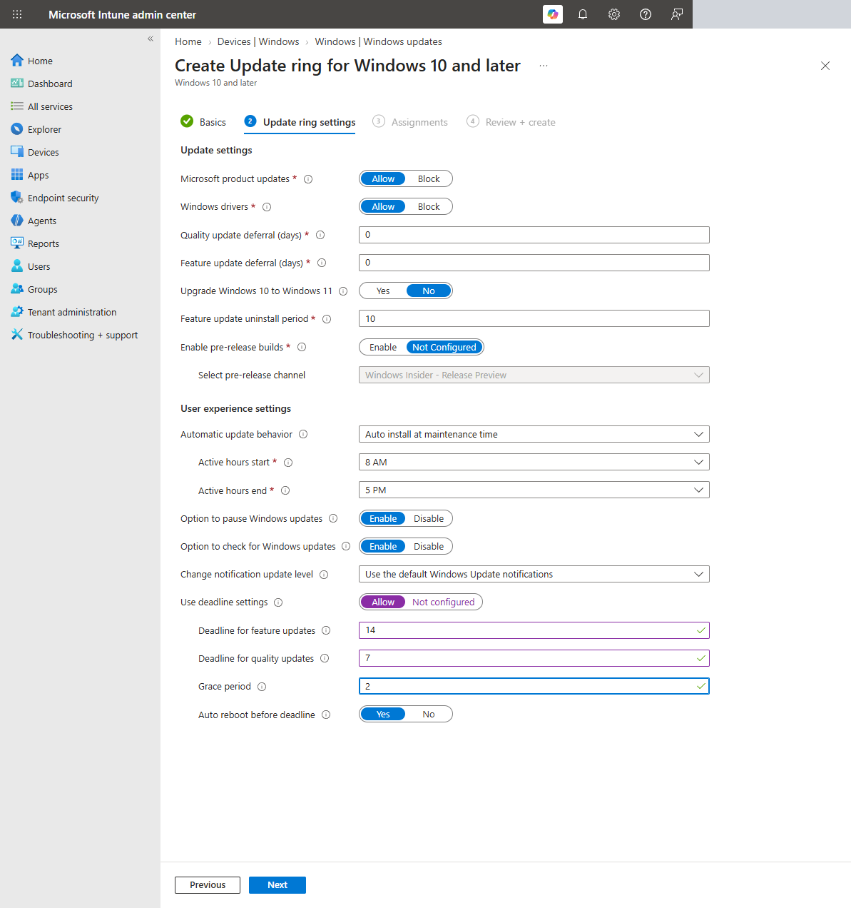

    Use these deadlines to control update and restart behavior. You still need installation results to check whether devices meet the 14-day objective.

13. Leave all other settings at their displayed defaults.
    Select **Next**.

14. On **Assignments**, leave all group assignments empty.
    This ring wizard goes directly from **Update ring settings** to **Assignments**; it has no **Scope tags** page.

    > [!Note] Do not add groups, **All users**, or **All devices**. Leave this ring unassigned for the lab.

15. Select **Next**.

16. Review the settings.
    Confirm there are **no assignments**.

17. Select **Create**.

18. Open the saved `ZT-Lab-Windows-Update-Ring`.

19. Select **Properties**.
    Confirm:
    - **Quality / feature update deferral:** `0` / `0` days.
    - **Upgrade Windows 10 to Windows 11:** **No**.
    - **Automatic update behavior:** **Auto install at maintenance time**.
    - **Active hours:** `8 AM` to `5 PM`.
    - **Use deadline settings:** **Allow**.
    - **Quality / feature deadlines:** `7` / `14` days.
    - **Grace period:** `2` days; **Auto reboot before deadline:** **Yes**.
    - **Assignments:** Included and excluded groups both empty.

    

    Review the saved settings and confirm that the assignment lists are empty. With no assignments, the ring does not apply these settings to any devices.

### Allow Hotpatch in a Separate Windows Autopatch Quality Update Policy

Reference: <[Windows quality update policies](https://learn.microsoft.com/windows/deployment/windows-autopatch/manage/windows-autopatch-windows-quality-update-overview).

1. Return to **Windows updates**.

2. Select **Quality updates**.

3. Select **Create > Windows quality update policy**.

4. On **Basics**, enter:
    - **Name:** +++ZT-Lab-Autopatch-Hotpatch+++
    - **Description:** Leave blank.

5. Select **Next**.

6. On **Update settings**, verify:
    - **Monthly B week updates:** **Automatically approve**, available after `0` days.
    - **Monthly D week preview updates:** **Manually review and approve**.
    - **Out-of-band security updates:** **Manually review and approve**.
    - **Out-of-band non-security updates:** **Manually review and approve**.
    - **Quick machine recovery updates:** **Manually review and approve**.

7. Under **Automatic update deployment settings**, set the control for **For monthly B-week security updates, when available, apply without restarting the device ("hotpatch")** to **Allow**.
    If Allow is already selected, retain it.

    

    Configure hotpatch in this Windows Autopatch quality update policy rather than in the update ring.

8. Select **Next**.

9. On **Scope tags**, retain **Default**, then select **Next**.

10. On **Assignments**, add no groups, **All users**, or **All devices**.
    Select **Next**.

11. On **Review + create**, confirm the name, approval settings, **Hotpatch Allow**, and **no assignments**.
    Select **Create**.

12. Reopen `ZT-Lab-Autopatch-Hotpatch` from **Quality updates**.
    The list should show **Hotpatch Enabled: Yes** and **Assigned: No**.

13. In saved **Properties**, confirm the approval settings, hotpatch **Allow**, **Default** scope tag, and empty included/excluded groups.
    Do not select **Edit** or assign devices.

    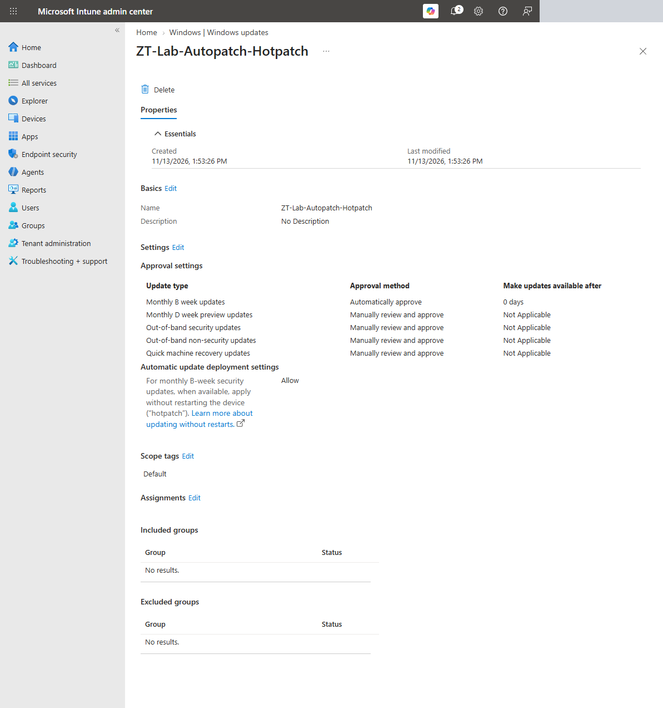

    Keep the quality update policy unassigned. **Allow** prepares the hotpatch setting, but the policy does not deploy updates to any devices.

### Record Both Device Configurations

1. Return to the **Zero Trust Workshop** tab.

2. Navigate to:
    **Devices > Update Rings**.

3. Set **Status** to **In Planning**.

4. Update **Notes** with both policy outcomes and how you would verify timely installation.
    Replace stale planned/deferred wording rather than duplicating it. Preserve the assessment observations and condense as needed within the **1,000-character limit**. Use this example only after verifying both saved policies; otherwise record which configuration is blocked:

    ```text
    Created ZT-Lab-Windows-Update-Ring without assignments.
    Quality updates: 0-day deferral, 7-day deadline, 2-day grace period.
    Created ZT-Lab-Autopatch-Hotpatch without assignments:
    monthly B updates automatically approved at 0 days; Hotpatch Allow.
    No devices patched. Next: Validate hotpatch eligibility, pilot both
    policies, and compare installation/restart results with release dates
    to track the 14-day objective. Baseline updates still require restarts.
    ```

5. Select **Save**.

6. Reopen the task and confirm your note and **In Planning** status were retained.

> [!Note] Quality-update deadlines depend on when devices discover updates and complete restarts. Use installation reporting to track the 14-day objective, including offline devices. Feature updates have a separate deadline.

### Check Your Work

Confirm that `ZT-Lab-Windows-Update-Ring` has every specified setting and **no assignments**. Confirm that `ZT-Lab-Autopatch-Hotpatch` has **Hotpatch Allow**, monthly B approval at `0` days, the other specified approval settings, and **no assignments**. Confirm your Workshop note records both outcomes or blockers and remains **In Planning**. With no assigned devices, neither configuration demonstrates installed updates or active device hotpatching.

To evaluate the 14-day target in a deployment, compare update release dates with each in-scope device's installed update/build, installation timing, and restart status. Include overdue and offline devices in the follow-up. Capture this reporting step in your Workshop note.

===

## Section 5 - Inventory Agents, Owners & Access

Review the agent example below to identify ownership and access-review questions. No configuration or Workshop entry is required.

Agents should have an accountable owner and only the access needed for their purpose, consistent with Zero Trust least privilege. The Agent 365 registry in the Microsoft 365 admin center provides a starting point for reviewing agents. Available details vary by agent capabilities; permissions and resource-side access evidence establish what an agent can access.

### Inventory, Ownership, and Access

- **Inventory:** A record of agents and their intended jobs provides a starting point for governance.
- **Ownership:** An accountable owner is responsible for an agent's use. A publisher or creator is not necessarily the current owner.
- **Access:** The resources and operations available to an agent should match its job. Application permissions allow access without a signed-in user; delegated access is bounded by the signed-in user's permissions and the granted scopes.

### Example - Contract Policy Expert

**Contract Policy Expert** answers contract-policy questions. Review its purpose and ownership alongside its configured knowledge, tools, and usage.


Use the **Details** pane to identify the agent and review its description, publisher, and owner. Establish who can confirm its purpose and access needs; the publisher is not necessarily the accountable owner.

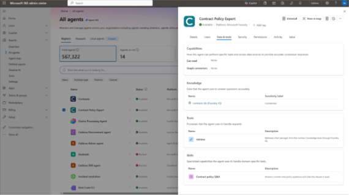

Review the configured knowledge source, retrieval tool, and contract-policy skill on the **Data & tools** tab to understand how the agent answers questions. Then compare its permissions with resource-side access evidence; configured sources alone do not establish everything it can access.


Use active users, sessions, exceptions, and trends on the **Activity** tab to understand usage and prioritize review. Assess permission scope and answer quality separately.

To complete an access review, inspect the agent's permissions and the resources those permissions allow it to use. Compare the allowed operations with its purpose, distinguishing its own application permissions from a signed-in user's delegated access. The example above does not include that permissions review and does not establish excess access.

**Key takeaway:** Know the agent's job, identify its owner, and verify that its access matches its purpose.

### Learn More

- <[Agent registry](https://learn.microsoft.com/en-us/microsoft-agent-365/admin/agent-registry-overview)
- <[Agent details and permissions](https://learn.microsoft.com/en-us/microsoft-agent-365/admin/agent-details#agent-permissions)
- <[Agent access: its own identity or a person's behalf](https://learn.microsoft.com/en-us/microsoft-agent-365/guidance/agent-authority)
- <[Microsoft Agent 365 overview](https://learn.microsoft.com/en-us/microsoft-agent-365/overview)
- <[Zero Trust Workshop: AI security](https://learn.microsoft.com/en-us/security/zero-trust/workshop-zero-trust-ai-security)

===

## Section 6 - Classify & Protect Data

Review the data-protection example below to connect classification and sharing findings with protection decisions. No configuration or Workshop entry is required.

Sensitive information needs an appropriate classification and protection, consistent with Zero Trust least privilege. Microsoft Purview Data Security Posture Management (DSPM) provides a starting point for finding classification gaps and potential oversharing. Microsoft 365 Copilot respects existing permissions; it does not correct permissions that are too broad.

### Classification and Protection

- **Sensitivity:** A classification taxonomy defines sensitivity levels and how information should be handled.
- **Classification:** A sensitivity label identifies the information's classification. A **Confidential** marking alone does not restrict access.
- **Protection:** Sharing permissions and label-applied encryption can restrict access and usage. A separate, label-based Data Loss Prevention (DLP) policy can restrict processing by Copilot and agents.

### Example - A Classified File Still Needs Access Review

**This file is labeled Confidential. Is its access appropriate?** Follow one finding from **SP Oversharing Assessment** to connect classification and sharing information with protection options.


Review the approximately 23.2K unlabeled items for classification gaps and the 101 potentially overshared items for sharing risk. Treat these as separate review needs, not confirmed leaks.

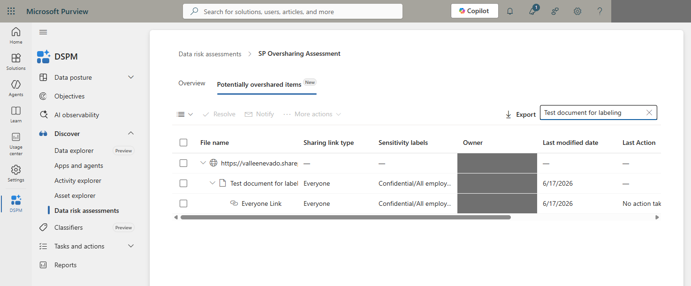

Examine **Test document for labeling.docx**: it has the label **Confidential/All employees** and an **Everyone** sharing link flagged for review. Before changing access, confirm the link's audience, business need, and effective protection with the owner.


Review the site's **Protect** tab for guidance on using a label-based DLP policy to **Exclude Copilot and agents from processing**. Consider this option for information that should not be processed by AI, alongside correcting inappropriate SharePoint access.

The <[review-actions view](instructions359866/17b-dspm-review-actions.png) offers an action to remove a sharing link. Choosing a remediation requires confirming the audience and business need first. This example reviews findings and protection options; it does not change sharing, verify encryption settings, or configure a DLP policy.

**Key takeaway:** Before expanding Copilot, review a sensitive-data location: check its classification, validate who can access it, and verify the protection it needs.

### Learn More

- <[DSPM data risk assessments and remediation](https://learn.microsoft.com/en-us/purview/data-security-posture-management-oversharing)
- <[Sensitivity labels](https://learn.microsoft.com/en-us/purview/sensitivity-labels)
- <[Apply encryption using sensitivity labels](https://learn.microsoft.com/en-us/purview/encryption-sensitivity-labels)
- <[Copilot permissions, labels, and encryption](https://learn.microsoft.com/en-us/copilot/plan/architecture-data-protection-auditing)
- <[Secure data with Zero Trust](https://learn.microsoft.com/en-us/security/zero-trust/deploy/data)

**Workshop connections:** <[Define the taxonomy](https://microsoft.github.io/zerotrustassessment/docs/workshop-guidance/data/RMT_006), <[manually classify sensitive assets](https://microsoft.github.io/zerotrustassessment/docs/workshop-guidance/data/RMT_008), and <[protect critical assets](https://microsoft.github.io/zerotrustassessment/docs/workshop-guidance/data/RMT_025). The first two introduce classification through a pilot without usage restrictions; protection is a subsequent decision. This overview shows review evidence and protection guidance, not completion of those deployment steps.

===

## Section 7 - Review Your Workshop Progress Report

Open the Workshop report to review your saved task statuses and notes. Check that your notes describe what you found, the configurations you verified or could not complete, and what you would do next.

1. Return to your <[Zero Trust Workshop](https://zerotrust.microsoft.com/) tab.

2. Open each of the following tasks:
    - **Identity > Rollout Conditional Access with Authentication Strength controls**.
    - **Devices > Update Rings**.

3. Confirm that each task remains **In Planning** and that its observations, verified configuration result or blocker, and next steps are saved.

4. Select **Actions > Report**.
   Allow the report to open in a new tab.

    If no report opens, check the browser's new-tab handling and invoke **Actions > Report** again. An empty report page is not successful generation.

    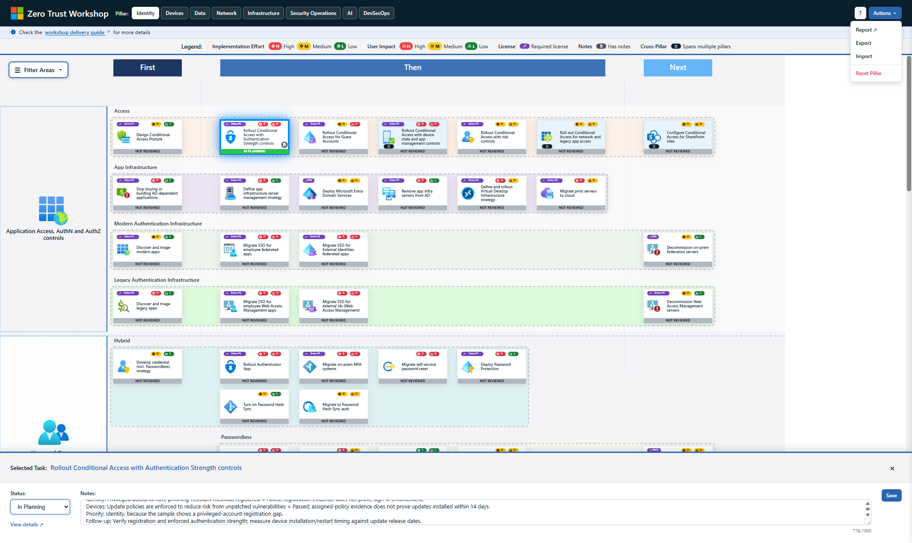

    Save your task notes before generating the report so it includes your latest updates.

    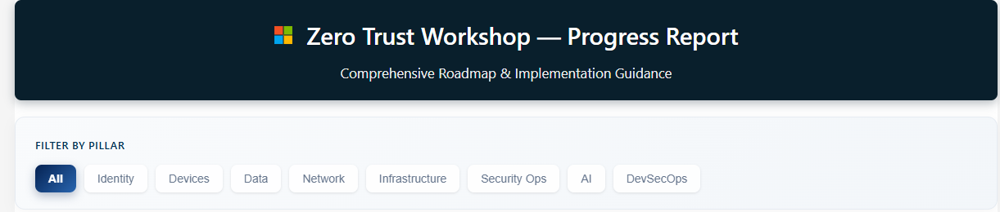

    Select **All** for the combined report, or choose **Identity** or **Devices** to focus on one pillar at a time.

5. Under **Filter by Pillar**, select **Identity**.
   Repeat the following review with **Devices**, one pillar at a time. Use **All** for the combined report.

6. Go to **Implementation Roadmap**.
   Compare the recommended authentication and device-update steps with the next steps in your notes.
   Its timeframes are planning guidance, not verified deployment dates.

7. Go to **Task Summary (Reviewed tasks)**.
   Review aggregate completion and pillar/functional-area breakdowns. This section is not a named task list.

8. Review **Status Distribution**.
   The report groups the editor's **In Planning** status under **Planned**. This does not indicate completed rollout.

    

    Expand the Identity note to review the policy configuration and next steps. The task appears as **Planned** in the report because it remains **In Planning** in the task editor.

    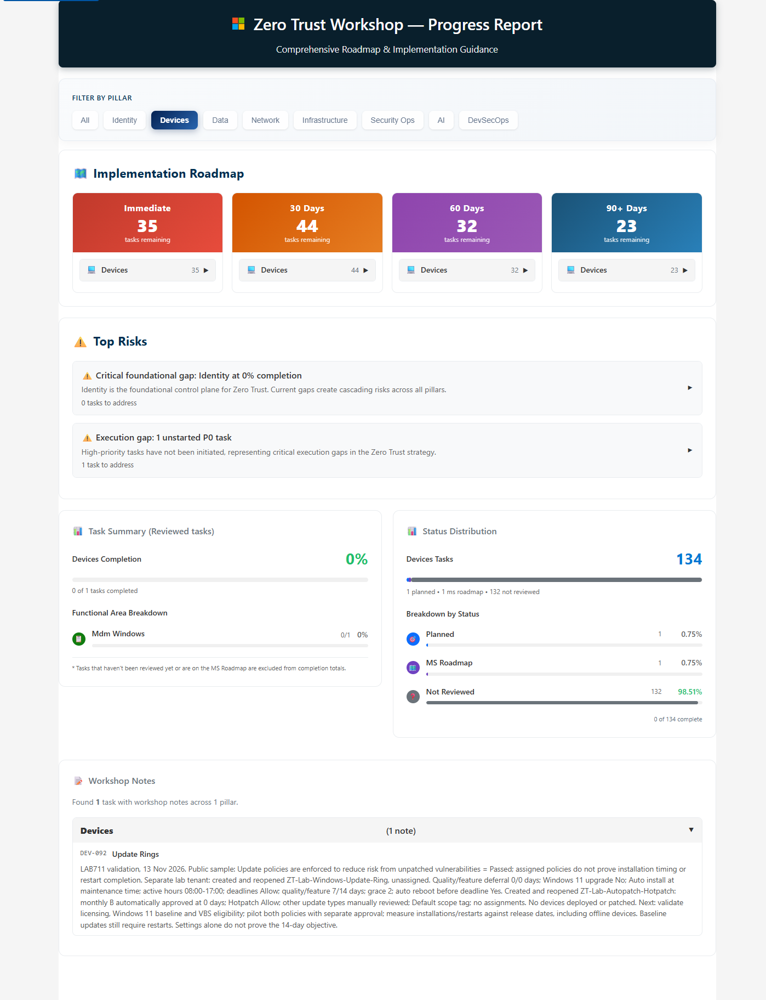

    Review both unassigned device policies in the **Update Rings** note. Keep the task **In Planning** until pilot testing and rollout are complete.

9. Go to **Workshop Notes**.
   Expand the relevant pillar row to find:
    - **Rollout Conditional Access with Authentication Strength controls (RMI_141)**.
    - **Update Rings (DEV-092)**.

    Under **All**, expand both rows. Confirm the notes include both assessment findings, your priority and rationale, honest configuration outcomes, and follow-up evidence.

    

    Use the two notes to connect your findings with the policies you configure and the work that remains. Distinguish the saved Report-only and unassigned settings from protection you still need to test and deploy.

10. Choose one next step to take back to your organization.

11. If the next step is missing from your notes:
    - Return to the relevant Workshop task.
    - Append the next step in **Notes**, within the **1,000-character limit**.
    - Select **Save**.
    - Generate a fresh report with **Actions > Report** and recheck the note.

    Do not rely on refreshing an old report tab. A later refresh can show **No Report Data Available**; return to the Workshop and generate the report again.

### Check Your Work

Confirm the report includes your assessment notes, the identity policy and both device-policy outcomes or blockers, and your next steps. The two Workshop task entries cover these three policies; no additional hotpatch task is required. Sections 5 and 6 are review-only and do not require report entries. Update your notes as you test and deploy changes.

Default/unreviewed recommendations can also appear in the report. Completion percentages, roadmap priorities, and **Top Risks** reflect recorded planning state, not independent tenant inspection, installed updates, or effective protection.

===

## Section 8 - Review and Next Steps

### Review

Review what you learned about each AI-readiness action:

| AI-readiness action | What you practiced or reviewed | Next step |
|---|---|---|
| Phishing-resistant authentication | Created a scoped, report-only authentication policy. | Prepare methods and test with a pilot group. |
| Remove risky and dormant access | Reviewed risk and inactivity as separate reasons to investigate access. | Review access with resource owners. |
| Patch devices within 14 days | Created an unassigned ring and separate Windows Autopatch quality policy with hotpatch allowed. | Validate eligible devices, pilot both policies, and measure installation/restarts; baseline updates still require restarts. |
| Inventory agents, owners, and access | Reviewed who owns an agent and which permissions it needs. | Identify agents needing ownership or access review. |
| Classify and protect data | Reviewed a Confidential-labeled file flagged for potential oversharing and label-based Copilot/DLP protection guidance. | Validate sharing audience and effective access; choose and test appropriate protection. |

**Take back to your organization:** Choose one security issue to address. Use the Workshop guidance to plan the changes and decide how you will check that they work.

### Before You Leave

1. Return to the **Microsoft Entra admin center**:
   <[Microsoft Entra admin center](https://entra.microsoft.com/).

2. Navigate to:
   **Entra ID > Conditional Access > Policies**.

3. Open `ZT-Lab-Require-Phishing-Resistant-MFA`.
   Confirm it remains **Report-only** and targets only the empty lab pilot group.

4. Return to the **Microsoft Intune admin center**:
   <[Microsoft Intune admin center](https://intune.microsoft.com/).

5. Navigate to:
   **Devices > By platform > Windows > Manage updates > Windows updates > Update rings**.

6. Open `ZT-Lab-Windows-Update-Ring`.
   Under **Properties**, confirm there are **no assignments**.

7. Return to **Windows updates > Quality updates**.
   Open `ZT-Lab-Autopatch-Hotpatch`.
   In **Properties**, confirm **Hotpatch Allow** and **no assignments**.

8. Return to your **Workshop Progress Report** tab.
   Review your saved notes and next steps.
   If it shows **No Report Data Available**, return to the Workshop and generate it again with **Actions > Report**.

    > [!Note] If you are using a temporary lab environment, follow the platform's instructions for retaining your work before it expires.

9. Sign out of the admin portals when finished.

**End of Lab**

---

## Additional Resources

- <[Zero Trust Assessment demo](https://microsoft.github.io/zerotrustassessment/demo/).
- <[Zero Trust Workshop](https://zerotrust.microsoft.com/).
- <[Microsoft Zero Trust guidance](https://learn.microsoft.com/en-us/security/zero-trust/).
- <[Microsoft Zero Trust overview](https://learn.microsoft.com/en-us/security/zero-trust/zero-trust-overview).
- <[Microsoft Agent 365 overview](https://learn.microsoft.com/en-us/microsoft-agent-365/overview).
- <[Conditional Access: phishing-resistant MFA](https://learn.microsoft.com/en-us/entra/identity/conditional-access/policy-admin-phish-resistant-mfa).
- <[Conditional Access: report-only mode](https://learn.microsoft.com/en-us/entra/identity/conditional-access/concept-conditional-access-report-only).
- <[Intune: manage Windows update rings](https://learn.microsoft.com/en-us/intune/device-updates/windows/manage-update-rings).
- <[Intune: update ring settings](https://learn.microsoft.com/en-us/intune/device-updates/windows/ref-update-ring-settings).
- <[Windows Autopatch: quality update policies](https://learn.microsoft.com/windows/deployment/windows-autopatch/manage/windows-autopatch-windows-quality-update-overview).
- <[Windows Autopatch: hotpatch prerequisites and behavior](https://learn.microsoft.com/windows/deployment/windows-autopatch/manage/windows-autopatch-hotpatch-updates).
- <[Windows: enforcing update compliance deadlines](https://learn.microsoft.com/en-us/windows/deployment/update/wufb-compliancedeadlines).
